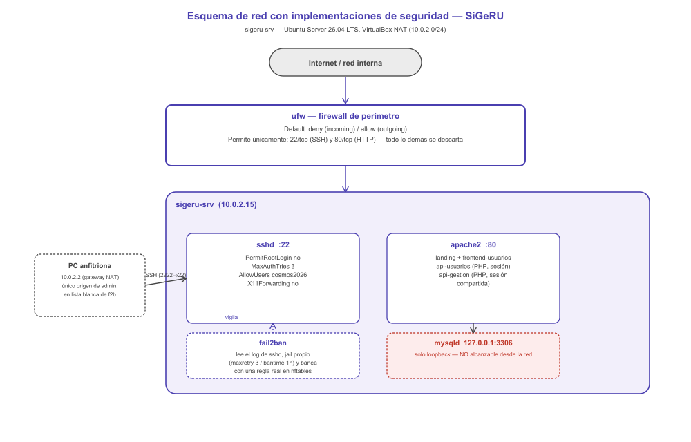

# Esquema de red con implementaciones de seguridad — SiGeRU

*(fuente: `generadores/diagrama_red_seguridad.py`, regenerable si cambia algún
puerto o servicio — dibujado directo con `reportlab`, en tema claro, sin pasar
por draw.io)*

## 1. Lectura del esquema

`sigeru-srv` es hoy un único servidor (Ubuntu Server 26.04 LTS) dentro de la
red NAT que arma VirtualBox (`10.0.2.0/24`, ver `red-estatica.md`). No hay
DMZ ni segmentación interna porque no hay más de un servidor todavía — el
plan de un segundo nodo tras un balanceador ya está documentado en
`respaldo-y-alta-disponibilidad.md` para cuando haga falta.

Tres servicios reales, y la implementación de seguridad de cada uno:

| Servicio | Puerto | Alcanzable desde la red | Seguridad aplicada |
|---|---|---|---|
| `sshd` | 22 | Sí, pero filtrado por `ufw` | `PermitRootLogin no`, `MaxAuthTries 3`, `AllowUsers cosmos2026`, sin X11 (`ssh.md`) + `fail2ban` vigilando el log |
| `apache2` | 80 | Sí, filtrado por `ufw` | Sirve la landing, el frontend y las dos APIs; la autorización real ocurre en la aplicación (`controles-de-acceso.md`), no en Apache |
| `mysqld` | 3306 (y 33060) | **No** — solo escucha en `127.0.0.1` | Aislado por diseño: ni siquiera depende de que `ufw` esté bien configurado |

## 2. Perímetro: `ufw`

Política por defecto **deny** para todo el tráfico entrante, con dos
excepciones explícitas (22/tcp y 80/tcp). Cualquier otro puerto — incluido el
3306 de MySQL, aunque ya esté a salvo por el *bind address* — queda
descartado antes de llegar a ningún proceso. Detalle de la configuración y su
prueba en `firewall-fail2ban.md`.

## 3. Detección y bloqueo: `fail2ban`

Vigila el log de `sshd` y banea, con una regla real en `nftables`, cualquier
origen que acumule 3 intentos fallidos en 10 minutos. El servidor de
administración (la PC anfitriona, único canal de acceso remoto hoy) está en
una lista blanca explícita y documentada — no es un firewall más permisivo,
es la misma política aplicada a todos los orígenes salvo el de
administración, con el motivo escrito en `firewall-fail2ban.md`.

## 4. Único canal de administración remota

Todo el acceso administrativo pasa por SSH desde la PC anfitriona
(`10.0.2.2`, el gateway de la red NAT), con reenvío de puerto
(`127.0.0.1:2222 → sigeru-srv:22`). No hay panel web de administración del
servidor expuesto, ni ningún otro puerto de gestión (no hay `phpMyAdmin` ni
consola de MySQL accesible desde la red — el cliente de MySQL solo puede
conectarse desde el propio servidor).

## 5. Qué no está en este esquema, a propósito

- **Sin HTTPS todavía** entre el navegador y Apache: reservado para la 3ra
  entrega (certificado SSL), ver `amenazas-y-vulnerabilidades.md`, sección 4.
- **Sin segmentación de red** (una sola subred, sin VLAN): no aplica con un
  solo servidor.
- **Sin IDS/IPS de red**: justificado en `firewall-fail2ban.md`, sección 5.
