# SiGeRU — Diseño del Sistema

**Versión:** 3.0 · **Fecha:** 05/11/2026 · **Estado:** revisión para el equipo y la docente.

## 1. Objeto y alcance de este documento

Actualizamos los diagramas de paquetes y clases para que muestren el sistema de la tercera entrega. El modelo de casos de uso, con sus fichas y láminas, está en el documento compañero. Conservamos los archivos de las entregas anteriores como registro de lo que se presentó en cada fecha. Esta revisión describe el diseño; no sustituye las pruebas del sistema.

## 2. De dónde sale cada diagrama

Partimos del `database/schema.sql` actual, de la ERS 3.0, de las fichas de casos de uso y de los cambios registrados entre el 18 y el 31 de octubre. Contrastamos las clases nuevas con las tablas del dominio. Los diagramas representan conceptos del sistema: un cuadro UML no significa que exista una clase PHP con el mismo nombre.

La base tiene 25 tablas: 21 del dominio y cuatro de soporte (`migracion`, `intento_login`, `limite_peticion` y `auditoria`). Esas cuatro no se dibujan como entidades del negocio. Tampoco mostramos cada clave foránea como atributo; la relación entre clases expresa ese vínculo.

## 3. Diagrama de paquetes

### 3.1 Qué modela y por qué hace falta

Las cinco carpetas separan acceso, usuarios, recursos, operación e informes. Mantuvimos la forma, los colores y las flechas del diagrama anterior. Ahora muestran 36 objetivos actuales de usuario.

### 3.2 Criterio de agrupamiento

CU-024, que era adjuntar una foto, se retiró. CU-004 y CU-027 describen controles internos y por eso no cuentan como objetivos de un actor. Los recorridos CU-033 a CU-039 cubren rutas, recolecciones, mapa, panel, recepción, stock y notificaciones.

### 3.3 Los cinco paquetes

- A: acceso y notificaciones. B: administración de usuarios. C: recursos, centros, mapa y stock. D: incidencias, rutas y recolecciones. E: informes y panel.

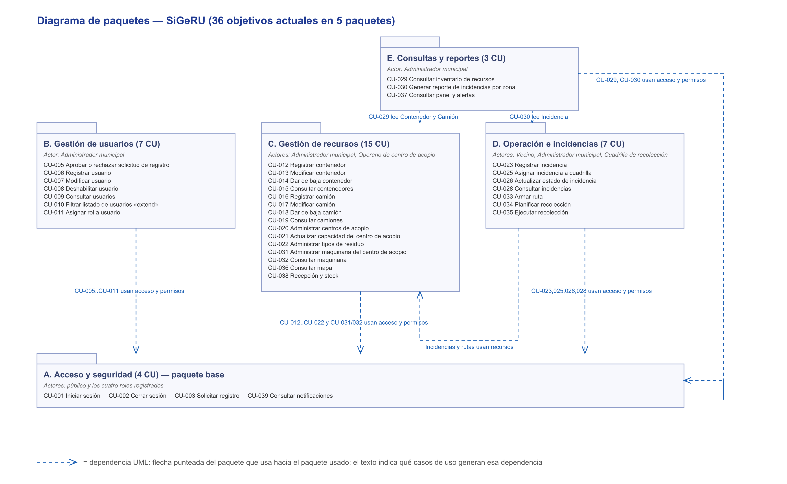

### 3.4 Las dependencias y su motivo

Una flecha punteada indica que una parte usa servicios o datos de otra. Por ejemplo, operación usa recursos para elegir contenedores y camiones; informes consulta incidencias. El control de permisos se aplica en la API, pero no lo dibujamos como un caso de uso «include» obligatorio.

### 3.5 Cómo se lee la figura

Cada caja lista los casos activos de ese paquete. El archivo `.drawio` queda editable y el PNG se puede ampliar sin perder la versión que se usó en este PDF.

## 4. Diagrama de clases

### 4.1 Qué modela y de qué se deriva

El dibujo reúne 21 clases del dominio. Conservamos las 15 del diseño anterior y agregamos RutaContenedor, HistorialIncidencia, Recepcion, MovimientoStock, HistorialMaquinaria y Notificacion. El atributo `cedula` se sumó a Usuario y SolicitudRegistro; el método de adjuntar fotos salió de Incidencia.

### 4.2 Cómo está organizado: las cuatro bandas

El diseño anterior tenía cuatro bandas. Esas cuatro siguen y sumamos una quinta para los componentes del tercer avance. Las vistas siguientes permiten leer los cuadros. El PNG completo y el archivo `.drawio` se pueden ampliar para ver todas las relaciones juntas.

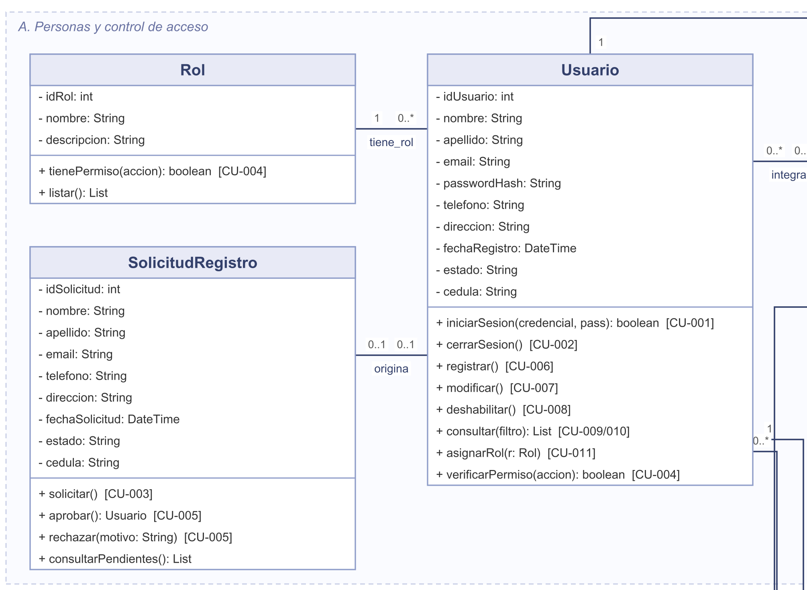

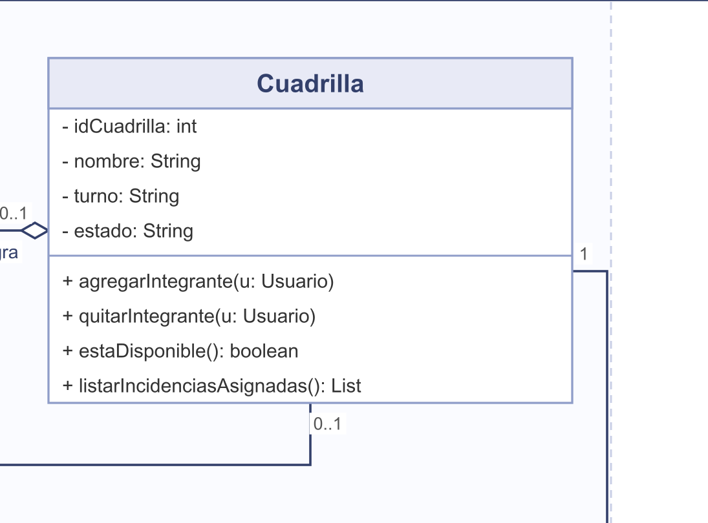

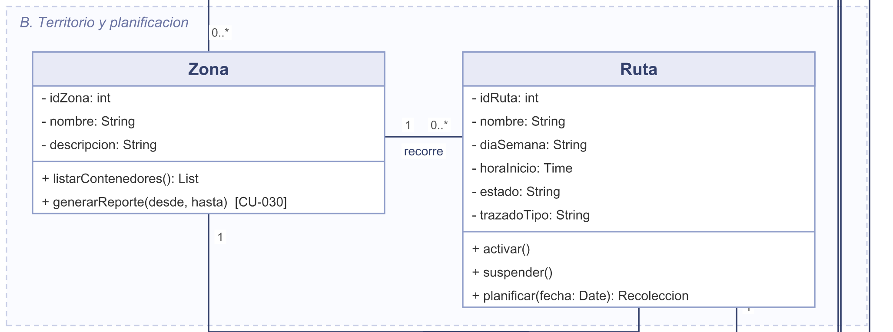

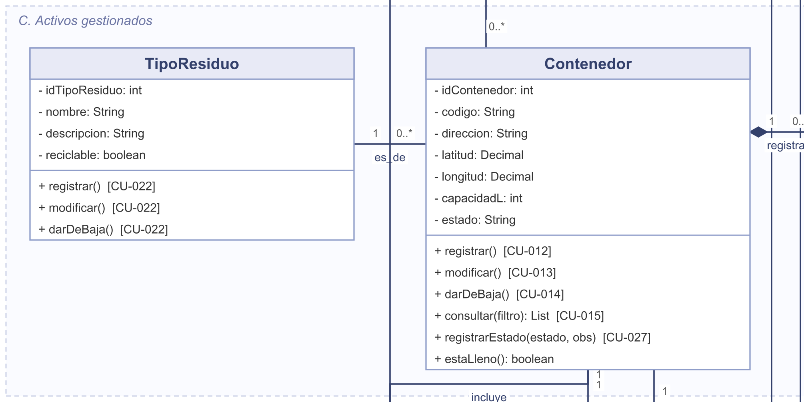

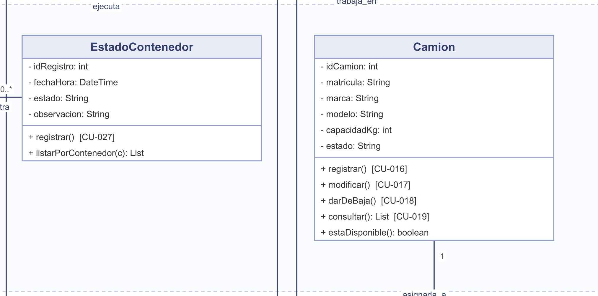

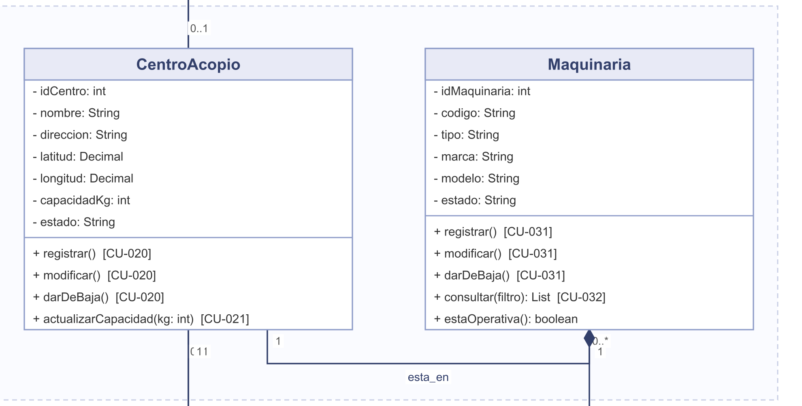

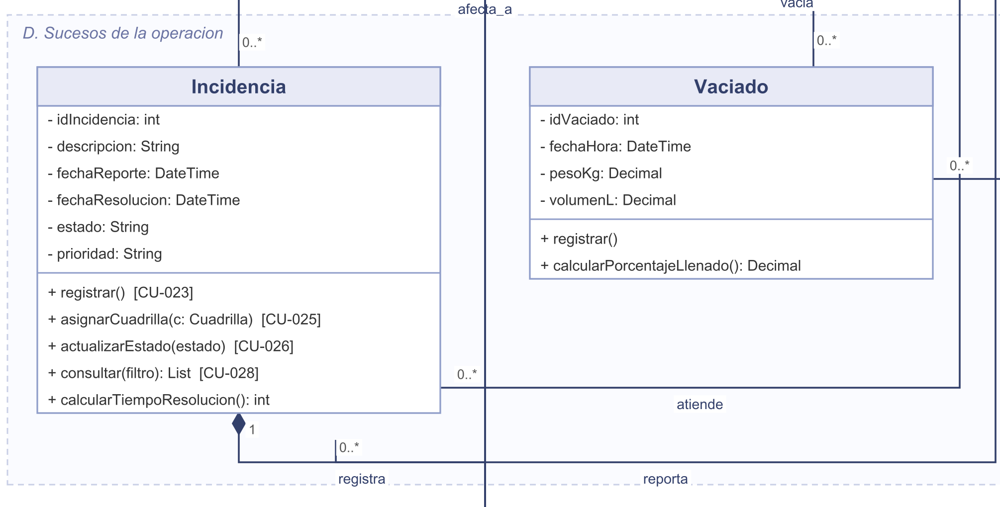

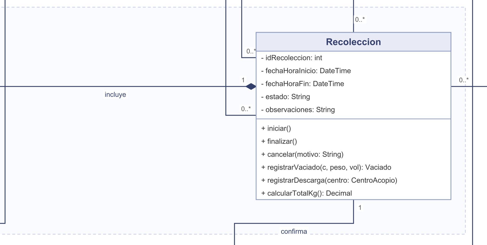

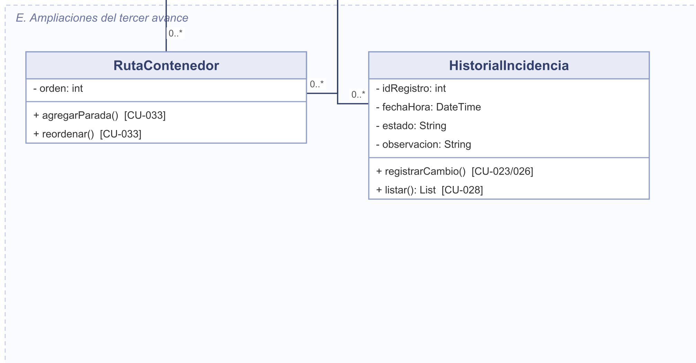

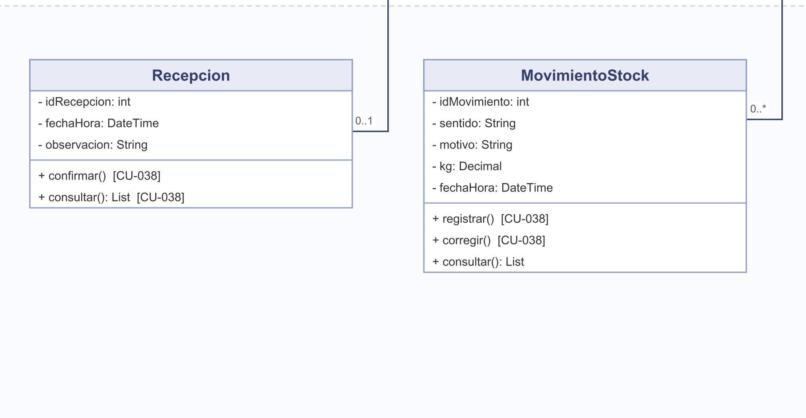

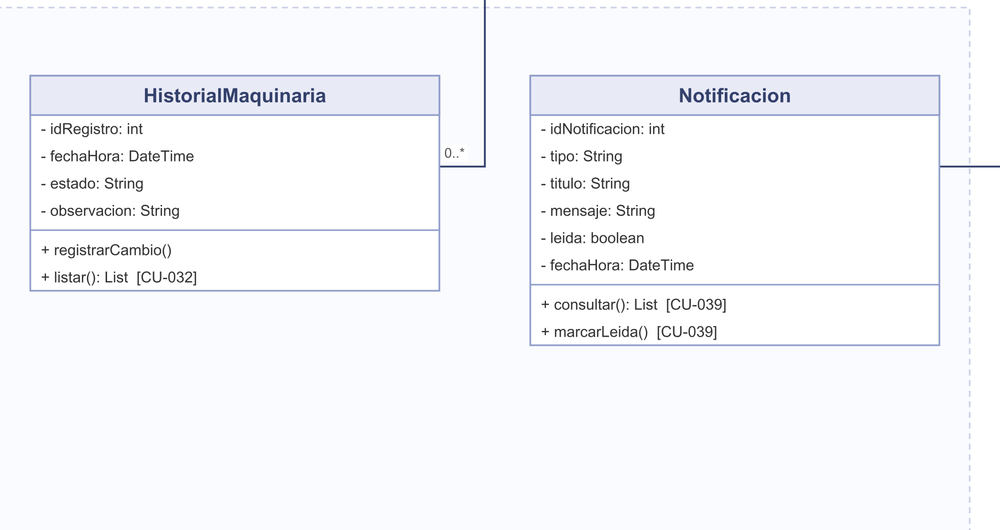

### 4.3 Los atributos, y por qué las claves foráneas no figuran

Incluimos los datos que ayudan a explicar cada entidad. Los identificadores que conectan tablas están representados mediante líneas entre clases. La versión física completa, con tipos, índices y claves, está en `database/schema.sql`.

### 4.4 Los métodos, y de qué caso de uso sale cada uno

Entre corchetes aparece el caso de uso que motiva una operación. Son responsabilidades del diseño, no firmas copiadas de PHP. CU-033 a CU-039 son recorridos nuevos propuestos para documentar el código actual y necesitan revisión del equipo.

### 4.5 Las asociaciones y su multiplicidad

El diagrama muestra 26 asociaciones principales. Por ejemplo, un operario puede estar asociado a un centro; RutaContenedor guarda el orden de las paradas, e HistorialIncidencia conserva cada cambio de una incidencia. La base tiene más claves foráneas que estas líneas: para leerlas todas hay que ir al esquema físico.

### 4.6 Composición, agregación y asociación simple

La línea simple indica una relación. El rombo lleno marca un registro que depende de otro, como el historial de una incidencia. El rombo vacío conserva la agrupación de usuarios en una cuadrilla. La interpretación exacta de las bajas se comprueba en las reglas `ON DELETE` del esquema.

### 4.7 Cómo leer las figuras

El nombre está arriba, los atributos en el medio y las operaciones abajo. Las líneas llevan nombre y multiplicidad. Las imágenes de detalle salen del mismo PNG general: no son versiones diferentes.

## 5. Diagrama de estados

### 5.1 Por qué se incluye

La letra lo marca como opcional. El documento anterior conserva los dibujos de estados de septiembre; acá dejamos claros los valores que usa la base actual y evitamos presentarlos como si esos dibujos se hubieran actualizado.

### 5.2 Ciclo de vida del contenedor

Los estados guardados son disponible, lleno, mantenimiento y retirado. Los cambios relevantes quedan en `estado_contenedor`, que es de solo agregado.

### 5.3 Ciclo de vida de la incidencia

Los estados guardados son abierta, en curso, resuelta y descartada. `historial_incidencia` registra actor, fecha y observación.

### 5.4 Los demás estados del sistema

Una recolección puede estar planificada, en curso, finalizada o cancelada. Los estados y transiciones exactos se validan en la API y en el plan de testing.

## 6. Verificación de consistencia entre los modelos

| Cambio de octubre | En clases | En casos de uso |
|---|---|---|
| Cuadrilla entra con cédula | Usuario y SolicitudRegistro tienen cédula. | CU-001 y CU-003. |
| Operario tiene centro asignado | Usuario se asocia con CentroAcopio. | CU-021 y CU-038. |
| Foto retirada | Incidencia ya no tiene operación de foto. | CU-024 queda histórico y fuera del diagrama. |
| Rutas y recolección | RutaContenedor y Recepcion completan el recorrido. | CU-033 a CU-035. |
| Avisos y stock | Notificacion y MovimientoStock figuran en el modelo. | CU-038 y CU-039. |

## 7. Cómo se regeneran los diagramas

Las fuentes editables están en `generadores/diagrama_clases_v3.py`, `diagrama_paquetes_v3.py`, `render_diagramas_v3.py` y `casos_uso_v3.py`. Los `.drawio` y PNG de esta versión están juntos en `diseno-3ra/`. El equipo puede corregir el modelo en esas fuentes y volver a generarlo; no hace falta dibujarlo de cero.

## 8. Fuentes

- `database/schema.sql` y `database/migraciones/021-quitar-foto-incidencia.sql`.
- ERS 3.0, plan de testing y casos de uso 3.0.
- `ampliacion-operario-3ra.md`, `ampliacion-cedula-cuadrilla-3ra.md` y `ampliacion-simplificacion-2-3ra.md`.
