# Plan de testing de SiGeRU

<!--
Versión 1.1 · 3 de noviembre de 2026 · Equipo COSMOS · Ingeniería de Software, tercera entrega.
Este archivo es el texto del plan. El PDF se arma con generadores/doc24_plan_testing.py; si se cambia
algo, se cambia acá y se vuelve a generar. La sección «Resultados de la corrida» la escribe el
generador a partir de las salidas guardadas en evidencia/: no editarla a mano.
-->


## Identificador e introducción

**Identificador:** PT-SIGERU-01, versión 1.2. La versión 1.0 era del 30 de octubre y se escribió antes de mirar el código en detalle. Al compararla con el sistema encontramos datos que no coincidían (rangos, estados, permisos y funciones que no existen), así que la rehicimos. Lo que cambió está en la historia de revisiones.

SiGeRU es el sistema que hicimos para gestionar residuos urbanos: contenedores, incidencias que informan los vecinos, recolecciones de las cuadrillas, rutas, centros de acopio y maquinaria. Lo usan cuatro roles: Administrador, Operario (del centro de acopio), Cuadrilla y Vecino.

Este plan dice qué probamos, cómo lo probamos, con qué datos y qué resultó. Probamos para encontrar errores antes de que los encuentre un usuario. Nos importan más tres cosas:

1. Que cada rol pueda hacer solo lo que le corresponde. Si un vecino pudiera cambiar una incidencia o dar de baja un contenedor, el sistema no sirve.
2. Que los datos queden bien guardados. Una incidencia mal cerrada o un contenedor con un estado falso confunde a la cuadrilla en la calle.
3. Que el sistema rechace los datos malos con un mensaje claro, y sin dejar registros a medias.

Por eso le dimos más peso a los accesos, a las incidencias y a las recolecciones, y probamos muchos casos donde lo correcto es que el sistema diga que no.

## Elementos a probar

Probamos estas partes del sistema:

| Parte | Qué es |
|---|---|
| `landing/` | La página pública: información, mapa público y formulario para pedir una cuenta. |
| `frontend-usuarios/` | Las pantallas de los cuatro roles, incluido el panel del Administrador. |
| `api-usuarios/` | Cuentas, inicio y cierre de sesión, solicitudes de registro, cédula. |
| `api-gestion/` | Contenedores, incidencias, centros, maquinaria, stock, avisos, reportes, auditoría. |
| `api-recoleccion/` | Camiones, cuadrillas, rutas, recolecciones, vaciados y asignación de rutas. |
| Base de datos | 25 tablas: 21 del modelo y 4 de soporte (`migracion`, `intento_login`, `limite_peticion`, `auditoria`). |

La versión probada es la del commit `7c780d5` del repositorio, más los cambios del 30 y 31 de octubre que todavía no están commiteados (cédula de la cuadrilla y quitar el correo). La fecha y la hora exactas de cada corrida están en la sección de resultados.

## Funcionalidades a probar

| Área | Qué comprobamos | Prioridad |
|---|---|---|
| Acceso y roles | Inicio de sesión con correo (Administrador, Operario, Vecino) y con cédula (Cuadrilla), cierre de sesión, cuenta dada de baja, límite de intentos, que cada rol vea y haga solo lo suyo. | Alta |
| Usuarios y solicitudes | Pedido de cuenta de vecino y de cuadrilla, aprobación con contraseña inicial, alta, edición y baja de usuarios. | Alta |
| Contenedores | Alta, consulta, edición y baja lógica; validación de código, dirección, capacidad, ubicación, zona y tipo de residuo; tope de 100 por zona. | Alta |
| Incidencias | Registro, número INC, prioridad según el tipo, asignación a cuadrilla, avance, resolución, descarte, derivación a mantenimiento, historial que no se puede borrar. | Alta |
| Recolecciones | Planificar, iniciar, registrar vaciados, finalizar y cancelar; el camión cambia de estado solo. | Alta |
| Rutas | Armar rutas con contenedores (hasta 25 paradas), asignarlas a cuadrillas, que la cuadrilla vea solo las suyas. | Alta |
| Centros, maquinaria y stock | Datos de los centros, estado de la maquinaria con historial, recepciones y stock del Operario. | Alta |
| Avisos | La campanita: quién recibe cada aviso y que cada uno vea solo los suyos. | Media |
| Reportes y mapa | Informe de incidencias y de recolección, descarga del detalle en CSV, botón «Imprimir», panel por urgencias, mapa interno y mapa público sin datos personales. | Media |
| Seguridad | Permisos en la API (no solo en la pantalla), inyección SQL, auditoría, archivos que no se publican. | Alta |
| Interfaz | Mensajes, formularios, pantallas a 375, 768 y 1360 px, contraste y teclado. | Media |

## Funcionalidades que no se prueban

Estas cosas quedaron afuera, y decimos por qué:

- **Exportar el informe a PDF.** No existe: solo se puede imprimir. El CSV de las incidencias sí existe desde el 03/11 (DEF-17: la versión 1.0 de este plan y la especificación lo daban por hecho y no estaba).
- **Correo y «Olvidé mi contraseña».** Las sacamos del sistema el 30/10. Ahora el Administrador define la contraseña inicial y la restablece.
- **Foto de la incidencia, predicción de llenado, impacto ambiental, guía «¿Dónde tiro esto?», uso sin conexión.** También se sacaron (25 y 30/10). Si alguna de estas funciones aparece en un documento viejo, ese documento describe el sistema anterior.
- **Cambiar el idioma (RF-216, RNF-006) y contenedores de repuesto (RF-026, RF-027, RF-103, RF-191).** Están en la especificación como «pendientes de definición» y no se programaron. No las podemos probar porque no existen; lo decimos en la matriz.
- **MySQL 8.** Probamos en MariaDB 10.4 (XAMPP) porque es la base que tenemos en el pendrive. En Docker usamos MariaDB 10.11. No armamos un entorno con MySQL 8.
- **Firefox, Safari y lectores de pantalla.** Hasta hoy probamos en un navegador con motor Chromium. Firefox quedó como caso a mano (CP-UI-05).
- **Sensores, GPS de camiones, conexión con la Intendencia y carga real de una ciudad.** No tenemos esos recursos.
- **Ataques a servicios de otros.** Las pruebas de seguridad se hicieron solo sobre nuestro sistema y en nuestras máquinas.

## Enfoque de las pruebas

### Niveles de prueba

Probamos en cuatro niveles. Cada uno encuentra errores distintos.

| Nivel | Qué es | Cómo lo hacemos en SiGeRU |
|---|---|---|
| Unitarias | Probar una pieza chica del código sola, sin base de datos ni servidor. | 19 archivos `tests/unitarias*.php` cargados por `tests/unitarias.php`. Última corrida guardada: 677 pruebas (06/11). |
| Integración | Probar que la API, el código y la base funcionan juntos. | 15 archivos `tests/correr-tests*.php` cargados por `tests/correr-tests.php`. Le hacen pedidos HTTP reales a las APIs y miran la respuesta y la base. Última corrida guardada: 969 pruebas (03/11). |
| Sistema | Probar recorridos completos desde la pantalla, con cada rol. | A mano en el navegador, con la base de pruebas (casos CP-UI). |
| Aceptación simulada | Que una persona que no programó el sistema haga una tarea. | Con las sesiones de validación de UTU LAB. Están pendientes. |

**Por qué no usamos PHPUnit, Jest ni Postman.** PHPUnit se instala con Composer, que necesita internet y agrega miles de archivos. El proyecto corre desde un pendrive con herramientas portables, así que escribimos un corredor propio de unas 40 líneas (está explicado al principio de `tests/correr-tests.php`). Cada prueba es una afirmación: «esperaba esto, obtuve esto otro». Si coinciden, pasa. Para los pedidos a la API usamos el mismo corredor en lugar de Postman, así las pruebas quedan guardadas y se pueden repetir con un solo comando.

**Cómo se corren:**

```
..\herramientas\php\php.exe sigeru\tests\unitarias.php
..\herramientas\php\php.exe sigeru\tests\correr-tests.php
```

Las unitarias no necesitan nada más. Las de integración necesitan Apache y MySQL encendidos y la base con los datos de prueba (`restaurar-base-demo.cmd`). Lo que crean lo borran al terminar.

### Caja negra: probar como usuario

En una prueba de **caja negra** no miramos el código. Le damos una entrada al sistema y miramos si la salida es la que dice la especificación. Por ejemplo, cargamos un contenedor con capacidad `abc` y esperamos que el sistema lo rechace con un mensaje.

Usamos caja negra para casi todo lo que hace un usuario, porque es lo que importa: que el sistema responda bien, sin importar cómo esté programado por dentro. Usamos tres técnicas:

- **Particiones de equivalencia.** Dividimos las entradas en grupos que el sistema debería tratar igual (válidas, vacías, con letras, negativas) y probamos un valor de cada grupo.
- **Valores límite.** Los errores suelen estar en los bordes. Si la capacidad va de 1 a 100000, probamos 0, 1, 100000 y 100001.
- **Tabla de decisión.** Para los permisos combinamos «quién es» con «qué quiere hacer» y escribimos qué debería pasar en cada combinación.

Las pruebas por HTTP son de caja negra: le piden algo a la API como lo haría la pantalla y comparan la respuesta. Además, en los casos donde lo correcto es rechazar, pedimos directo a la API, sin pasar por el formulario. La validación del navegador se puede saltear, así que la que cuenta es la del servidor.

### Caja blanca: probar mirando el código

En una prueba de **caja blanca** sí miramos el código. Buscamos cada condición (cada `if`) y armamos un caso que pase por el lado verdadero y otro por el falso. Así nos aseguramos de que ninguna rama quede sin probar.

La caja negra solo ve el resultado final. Si una regla tiene tres condiciones y la caja negra prueba dos, la tercera puede estar mal y no nos enteramos. Por eso usamos caja blanca en las reglas más importantes, que además son funciones puras (no usan la base), y se pueden probar rápido y muchas veces.

**Cobertura.** No medimos la cobertura de líneas con una herramienta. El PHP portable no tiene Xdebug ni PCOV (lo comprobamos con `php -m`), así que no afirmamos un porcentaje. Lo que hicimos fue recorrer las ramas a mano en las cinco reglas de abajo y comprobar que cada una tiene su prueba.

#### Regla 1: límite de intentos de inicio de sesión

Archivo `api-usuarios/core/PoliticaBloqueo.php`. Después de 5 intentos fallidos en 15 minutos (900 segundos), la cuenta espera. La función `segundosDeEspera` tiene estas ramas:

| Condición del código | Caso que la recorre | Resultado esperado |
|---|---|---|
| Menos de 5 fallos dentro de la ventana | 4 fallos seguidos | Espera 0: puede seguir intentando |
| 5 fallos dentro de la ventana | 5 fallos en menos de 15 minutos | Espera hasta que el quinto fallo cumpla 15 minutos |
| Fallos viejos, fuera de la ventana | 5 fallos de hace más de 15 minutos | No cuentan: espera 0 |
| Más de 5 fallos | 7 fallos | Manda el quinto más reciente |
| El quinto fallo cumple justo 15 minutos | Reloj en el borde | Se levanta el bloqueo |
| `normalizar` recibe algo que no es texto, o un correo enorme | Número, correo de 300 letras | Queda vacío, o se recorta a 120 caracteres |

Pruebas: sección «7. Login: política de bloqueo por intentos» de las unitarias (8 pruebas) y sección «9. Límite de intentos de login» de las HTTP, donde el sexto intento devuelve 429.

#### Regla 2: el flujo de estados de una incidencia

Archivo `api-gestion/models/FlujoIncidencia.php`. Una incidencia está `abierta`, `en_curso`, `resuelta` o `descartada`. La tabla `ACCIONES` dice qué se puede hacer en cada estado:

| Acción | Se puede si está | Queda en |
|---|---|---|
| asignar a una cuadrilla | abierta o en curso | en curso |
| registrar un avance | solo en curso | en curso (no cambia) |
| resolver | abierta o en curso | resuelta |
| descartar | abierta o en curso | descartada |
| cambiar la prioridad o derivar | abierta o en curso | no cambia |

Probamos cada acción en un estado permitido y en uno prohibido. Una incidencia resuelta no admite ninguna acción más, y un avance sobre una abierta pide asignarla primero. También probamos una acción que no existe. Pruebas: sección «9. Incidencias: el flujo de estados» de las unitarias (13 pruebas) y sección «15. Incidencias: el trabajo de la cuadrilla» de las HTTP.

#### Regla 3: lo que le pasa al contenedor

En el mismo archivo, dos funciones cambian el estado del contenedor solas:

| Condición | Caso | Resultado |
|---|---|---|
| Se informa «desbordado» o «lleno» y el contenedor está disponible | Desborde en CNT-001 | Pasa a lleno |
| Se informa «desbordado» y ya estaba lleno o en mantenimiento | Desborde en CNT-002 | No cambia |
| Se informa otro tipo de problema | «otro» en CNT-001 | No cambia |
| Se cierra la última incidencia abierta de un contenedor lleno o en mantenimiento | Resolver la única abierta | Vuelve a disponible |
| Se cierra una, pero quedan otras abiertas | Resolver una de dos | No cambia |
| El contenedor estaba disponible o retirado | Cerrar con contenedor retirado | No cambia |

Pruebas: sección «11. Incidencias: lo que le pasa al contenedor» de las unitarias (7 pruebas) y sección «16» de las HTTP.

#### Regla 4: la cédula con dígito verificador

Archivo `api-usuarios/core/Validacion.php`, función `cedula`. La cuadrilla entra con su cédula, así que tiene que ser válida. El último dígito se calcula con los pesos 2, 9, 8, 7, 6, 3, 4. Por ejemplo, para 4.100.001 la suma da 21, y el verificador es (10 − 1) mod 10 = 9. Por eso **41000019** es válida y **41000018** no.

| Condición del código | Caso | Resultado |
|---|---|---|
| Tiene letras u otros símbolos | `abc`, `1.234.56-72a` | No es cédula |
| Menos de 7 o más de 8 dígitos | `12345`, `123456789` | No es cédula |
| Puntos, guion y espacios | `4.100.001-9` | Se aceptan: se guardan solo los dígitos |
| Verificador incorrecto | `1234567-3` | No es cédula |
| Verificador correcto | `41000019` | Es cédula |

Pruebas: sección «9. Cédula: validación y formato» de las unitarias y sección «48. Usuarios: la cuadrilla de un usuario con rol Cuadrilla» de las HTTP.

#### Regla 5: datos de un contenedor y permisos por defecto

`api-gestion/models/ValidacionContenedor.php` revisa el alta y la edición. La capacidad es **opcional**; si viene, tiene que ser un entero de 1 a 100000 litros. La ubicación también es opcional, pero latitud y longitud van juntas, la latitud entre −90 y 90 y la longitud entre −180 y 180. En el alta, la zona y el tipo de residuo son obligatorios.

`api-gestion/core/Permisos.php` tiene una tabla con lo que puede hacer cada rol en cada recurso. Si un recurso no está en la tabla, la lista de roles queda vacía y **nadie** lo puede usar (denegación por defecto). Lo probamos con un recurso inventado. Pruebas: secciones «8. Permisos» y «16. Contenedores: validación de los datos» de las unitarias.

### Interfaz y accesibilidad

En octubre revisamos unas 30 pantallas en el navegador a 375 px (celular) y a 1000 o 1360 px (computadora), con los cuatro roles. Encontramos desbordes horizontales y los corregimos (están en la bitácora). Las unitarias también revisan cosas de la interfaz que se pueden comprobar sin abrir el navegador:

- Que cada página tenga título, idioma, una sola etiqueta `main` y etiquetas en los campos (sección «20. Accesibilidad»).
- Que el contraste de los colores cumpla el nivel AA en el tema claro y en el oscuro (sección «45. Tema claro y oscuro»).
- Que el menú no muestre pantallas que la API le niega a ese rol (sección «8»).

Lo que no se puede automatizar queda como caso a mano. Se hicieron el 03/11 (CP-UI-04 con teclado y CP-UI-06 a 375 px en simulación); quedan Firefox, un celular real y la tecla Escape.

### Seguridad

Todas las pruebas de permisos se hacen contra la API, no contra la pantalla. Probamos los cuatro roles y el pedido sin sesión. Además probamos:

- **Inyección SQL.** Correos como `admin@sigeru.uy' OR '1'='1` en el login, y SQL en filtros, búsquedas, ids y fechas. Ninguno entra ni cambia datos (sección «22l»).
- **Límite de intentos.** El sexto intento fallido da 429 (sección «9»).
- **Auditoría.** Cada cambio queda registrado con quién lo hizo, y nadie la puede borrar ni editar (sección «22k»).
- **Archivos privados.** `.git`, las pruebas, el SQL y la configuración dan 403 desde la web (sección «10»).

El análisis completo de seguridad, con la prueba de XSS en 10 tipos de dato, está en `ciberseguridad/analisis-owasp-3ra.md`. Esa prueba no forma parte de la corrida automática de hoy.

### Pruebas de mutación: probar las pruebas

Una prueba que nunca falla no sirve. Para saber si nuestras pruebas encuentran errores de verdad, rompimos el código a propósito (un «mutante») y miramos si alguna prueba se daba cuenta. Por ejemplo, hicimos que el menú le mostrara las incidencias al Operario, o que el camión no pasara a «en ruta» al iniciar una recolección.

| Fecha | Parte | Roturas | Detectadas |
|---|---|---|---|
| 12/10 | Base del frontend | 7 | 7 |
| 12/10 | Permisos y sesión | 7 del backend y 5 de las guardias | 12 |
| 12/10 | Incidencias (API) | 10 | 10 |
| 14/10 | Incidencias (pantallas) | 3 | 3 |
| 14/10 | Recolecciones | 5 | 5 |
| 14/10 | Mapa | 2 | 2 |
| 24/10 | Arreglos antes del congelamiento | 16 | 16 |
| 25/10 | Simplificación | 3 | 3 |

Después de cada mutación dejamos los archivos como estaban y comprobamos que no hubiera cambiado nada. Estas mutaciones se hicieron en esas fechas y no se repitieron hoy. Una vez, el 12/10, las mutaciones modificaron datos de la base y tuvimos que volver a cargar el seed. Desde entonces se corren con la base de pruebas.

### Regresión y revisión cruzada

**Regresión** es volver a correr las pruebas viejas después de un cambio, para ver que no rompimos algo que andaba. Como las pruebas son automáticas, las corremos completas antes de cada entrega y después de cada arreglo. Así detectamos el 24/10 que la suite se cortaba si se corría con el seed de defensa.

**Revisión cruzada** es que pruebe alguien distinto de quien programó. El código lo programó casi todo una sola persona, así que los casos a mano los tienen que ejecutar los otros integrantes. Los casos a mano del 03/11 los ejecutó la IA (CP-UI-01 a 08), así que todavía no hubo revisión cruzada por una persona del equipo.

## Criterios de aprobación y rechazo

Un caso **pasa** cuando el resultado obtenido es igual al esperado y además comprobamos los datos guardados. Que la pantalla diga «guardado» no alcanza: después de un alta, volvemos a pedir el registro.

| Estado | Qué significa |
|---|---|
| Pendiente | Todavía no se ejecutó. |
| Aprobado | Se cumplió todo lo que pedía el caso. |
| Fallido | Se ejecutó y algo no coincide. Se anota en la bitácora de defectos. |
| Bloqueado | No se pudo ejecutar por algo externo (un servicio caído, una función que no existe). Se escribe el motivo. No cuenta como aprobado. |
| Omitido | El corredor no lo ejecutó porque falta algo del entorno (por ejemplo, internet para el trazado de rutas). Se informa aparte. |

En los casos negativos, que el sistema rechace es el resultado correcto. Comprobamos también que el rechazo no deje nada guardado a medias.

## Criterios de suspensión y reanudación

Paramos las pruebas si no funciona el inicio de sesión, si una API no responde, si la base queda inconsistente o si cambia la versión en el medio. Antes de parar anotamos el caso, el error, la hora y la versión.

Seguimos cuando se arregla la causa y pasa una prueba corta: iniciar sesión, consultar un contenedor y hacer un alta. Si se perdieron datos, restauramos la base con `restaurar-base-demo.cmd` y repetimos el caso que falló y su regresión.

## Entregables

- Este plan, con los casos y los datos de prueba.
- La salida completa de cada corrida automática, guardada en `ingenieria-software/testing-3ra/evidencia/` con fecha y hora en el nombre.
- El resumen de resultados por sección (más abajo).
- La matriz de trazabilidad.
- La bitácora de defectos.
- Las capturas y notas de los casos a mano (`CP-UI-*`, 03/11) y las fichas que complete el equipo.

Los manuales de uso, de instalación y de administración se entregan aparte.

## Entorno de pruebas

| Recurso | Lo que usamos |
|---|---|
| Servidor de desarrollo | XAMPP portable 8.2.12 en el pendrive: Apache 2.4 y PHP 8.2.33. |
| Base de datos | MariaDB 10.4.32. La base `sigeru` se recrea antes de cada corrida con `schema.sql` y `datos_prueba.sql`. |
| Servidores del proyecto | Dos máquinas virtuales con Rocky Linux 9.8: instalación tradicional (PHP 8.0) y Docker (PHP 8.3, MariaDB 10.11). Ahí solo comprobamos con `curl`, el 31/10, que respondieran la landing, el mapa público y el inicio de sesión. La suite no se corrió en las VM. |
| Navegador | Navegador con motor Chromium, a 375, 768 y 1360 px. |
| Herramientas | Los corredores propios de `tests/`, la consola del navegador y la línea de comandos de MariaDB. |
| Cuentas | Las del seed de pruebas (ver «Datos de prueba»). |

**Cuidado con la base.** Antes de cada corrida, `restaurar-base-demo.cmd` guarda una copia en `respaldo-bd/` y carga el seed de pruebas. Si se corre la suite con el seed de defensa, se corta: hay una zona con el tope de 100 contenedores ya ocupado. Al terminar se vuelve a cargar el seed de defensa con `restaurar-base-defensa.cmd`.

## Responsables

Esta organización es una propuesta. Cada integrante tiene que confirmar lo suyo.

| Integrante | Responsabilidad |
|---|---|
| Franco Fornos | Preparar la versión y el entorno, correr las pruebas automáticas, corregir los defectos del código. [CONFIRMAR] |
| Franco Astorino | Revisar el plan y la matriz, ejecutar casos a mano de incidencias y reportes. [CONFIRMAR] |
| Axel Delgado | Ejecutar casos a mano de interfaz, teclado y Firefox; probar en las VM. [CONFIRMAR] |
| Francisco Goycochea | Ejecutar casos a mano de acceso y cuentas, y revisar que las pruebas dejen la base como estaba. [CONFIRMAR] |

Quien corrige un defecto no lo cierra solo: otro integrante repite el caso.

## Cronograma

| Fecha | Qué hacemos | Resultado |
|---|---|---|
| 30/10 | Primera versión del plan (1.0). | Plan sin datos reales. |
| 03/11 | Rehacer el plan con el código real. Correr las pruebas automáticas. | Plan 1.1, 663 unitarias y 969 HTTP. |
| 03/11 | Ejecutar los casos a mano CP-UI (los hizo la IA, con capturas). | Resultados cargados; hallazgos DEF-16 a DEF-18. |
| 03/11 | Arreglar DEF-16 y DEF-17, agregar sus pruebas y repetir CP-UI-03 y CP-UI-08. | 676 unitarias y 969 HTTP en verde; los dos casos aprobados. |
| 06/11 | Agregar el caso límite de capacidad mínima (CP-CON-03) y correr las unitarias. | 677 unitarias aprobadas, 0 fallidas; salida en `evidencia/unitarias-20261106-1035.txt`. Las HTTP no se repitieron. |
| 04/11 | El equipo repite dos o tres casos, prueba en Firefox y en un celular real, y completa las fichas. Corte a las 20:00. | Fichas con capturas propias. |
| 05/11 | Repetir lo que falle, regresión completa, leer el documento. | Versión final. |
| 06/11 | Entrega. | — |

## Riesgos

| Riesgo | Qué hacemos |
|---|---|
| Correr la suite con la base equivocada (seed de defensa). | Restaurar el seed de pruebas antes; está escrito en el entorno. |
| Una mutación o una corrida cortada deja datos de prueba en la base. | La suite borra lo suyo al terminar; si se corta, se restaura el seed. |
| Una sola persona programó casi todo y los casos a mano los hizo la IA, no una persona del equipo. | Repartir la repetición de los casos CP-UI entre los otros tres integrantes y anotarlo en las fichas. |
| Probar solo en Chromium y en la PC de desarrollo. | Caso a mano en Firefox y en un celular real (CP-UI-05 está bloqueado hasta que alguien lo haga). |
| La cuenta de una cuadrilla que entra con el correo cuenta como intento fallido; en una demo puede activar el bloqueo. | En la demo, la cuadrilla entra siempre por la pestaña «Cuadrilla» con su cédula. |
| Lo probado en XAMPP (PHP 8.2) no corre igual en Rocky (PHP 8.0). | Una prueba unitaria impide usar funciones posteriores a PHP 8.0 (sección «53»). |

## Criterio de salida

Damos por cerrada esta etapa cuando:

1. Las pruebas automáticas pasan completas: 0 fallidas. Si hay omitidas, el motivo está escrito.
2. Los casos a mano se ejecutaron o están marcados como bloqueados con su motivo, y al menos dos fueron repetidos por una persona del equipo.
3. No queda ningún defecto de severidad alta abierto.
4. Otro integrante revisó los resultados.

Si llega la fecha y algo de esto falta, lo decimos en el informe. La fecha de entrega no convierte en aprobado lo que no se probó.

## Datos de prueba

Usamos el seed de pruebas `database/datos_prueba.sql`, siempre recién cargado. Todas las cuentas usan la clave de prueba del seed, que está en el `README.md` y no la repetimos acá. Los datos son inventados.

| Referencia | Dato real del seed |
|---|---|
| ADM | `admin@sigeru.uy` (Ana Pérez), Administrador, activa. |
| OPE | `operario@sigeru.uy` (Sergio Ferreira), Operario del Centro Felipe Cardoso (id 1). |
| CUA-1 | Luis Gómez, Cuadrilla Norte. Entra con la cédula **41000019**. Su correo es `cuadrilla@sigeru.uy`, pero con el correo recibe 403. |
| CUA-2 | Carla Núñez, Cuadrilla Sur. Entra con la cédula **41000025**. |
| VEC | `vecino@sigeru.uy` (Marta Rodríguez), Vecino, activa. |
| VEC-BAJA | `pablo.machado@mail.uy`, Vecino dado de baja (inactivo). |
| Cuadrillas | Norte, Sur y Centro activas; Este inactiva. |
| Contenedores | CNT-001 a CNT-010. CNT-001 disponible (1100 L, zona Cordón), CNT-002 lleno, CNT-005 en mantenimiento, CNT-010 retirado. |
| Incidencias | INC-0001 abierta (desborde en CNT-002), INC-0002 resuelta, INC-0003 en curso (Cuadrilla Sur), INC-0004 abierta, INC-0005 descartada. |
| Camiones | SBA-1234 operativo, SBB-5678 en ruta, SBC-9012 en mantenimiento, SBE-7890 fuera de servicio. |
| Rutas | Cuatro activas (Ciudad Vieja, Centro, Pocitos, Cordón) y una inactiva (Aires Puros). |

Las pruebas automáticas crean además sus propios registros de prueba (contenedores con código `TEST-` o `TINC-`, usuarios con correo `@test.uy`) y los borran al terminar. Así no tocan el historial de los datos del seed, que no se puede borrar.

## Casos de prueba de caja negra

Cada caso tiene un código, el requisito de la especificación (RF) y el caso de uso (CU) que prueba, los datos, lo esperado y lo obtenido. Cuando el caso lo cubre la prueba automática, la columna «Obtenido» dice en qué sección de la salida está. Esas salidas son las de la corrida del 03/11 (ver «Resultados de la corrida»).

### Acceso y cuentas

| Código | Requisito | Datos y pasos | Esperado | Obtenido |
|---|---|---|---|---|
| CP-ACC-01 | RF-002, CU-001 | ADM inicia sesión con correo y clave correctos. | Entra con rol Administrador. | Coincide (HTTP 1) |
| CP-ACC-02 | RF-002, CU-001 | ADM con una clave incorrecta. | 401, sin decir si falló el correo o la clave. | Coincide (HTTP 4) |
| CP-ACC-03 | RNF-002 | Seis intentos fallidos seguidos con el mismo correo. | Los 5 primeros dan 401; el sexto, 429 con el tiempo de espera. | Coincide (HTTP 9) |
| CP-ACC-04 | RF-002, CU-001 | CUA-1 entra con la cédula 4.100.001-9 y con 41000019. | Entra con rol Cuadrilla en los dos formatos. | Coincide (HTTP 48) |
| CP-ACC-05 | RF-002, CU-001 | CUA-1 entra con su correo y la clave correcta. | 403 con un mensaje que lo manda a la pestaña «Cuadrilla». | Coincide (HTTP 48) |
| CP-ACC-06 | RF-002 | Cédula con el verificador mal, cédula que no existe, cédula vacía. | 401 en los tres; nadie entra. | Coincide (HTTP 48) |
| CP-ACC-07 | RF-003, CU-002 | ADM cierra sesión y vuelve a pedir una pantalla protegida con la misma cookie. | Pide iniciar sesión otra vez (401). | Coincide (HTTP 22j) |
| CP-ACC-08 | RF-006, CU-008 | VEC-BAJA intenta usar el sistema. | No se le abre sesión; si ya la tenía, deja de servir. | Coincide (HTTP 9) |
| CP-ACC-09 | RF-001, RF-010, CU-003, CU-005 | Pedido de cuenta de cuadrilla sin sesión, con cédula válida; ADM lo aprueba eligiendo la cuadrilla y la contraseña inicial. | Se crea la cuenta con la cédula del pedido y entra con esa cédula. | Coincide (HTTP 49) |
| CP-ACC-10 | RF-001, CU-003 | El registro público intenta pedir rol Administrador o enviar `id_cuadrilla`. | Se ignora: queda como Vecino, sin cuadrilla. | Coincide (HTTP 49) |
| CP-ACC-11 | RF-010, CU-005 | Aprobar sin definir la contraseña inicial; aprobar dos veces. | 400 y 409. | Coincide (HTTP 49) |

### Contenedores y valores límite

La capacidad es un entero de 1 a 100000 litros, y puede quedar vacía. Estos son los valores límite:

| Código | Capacidad | Partición | Esperado | Obtenido |
|---|---|---|---|---|
| CP-CON-01 | vacía | Dato opcional ausente | Se acepta (sin dato) | Coincide (unitarias 16) |
| CP-CON-02 | 0 | Debajo del mínimo | Se rechaza | Coincide (unitarias 16) |
| CP-CON-03 | 1 | Mínimo | Se acepta | Coincide (unitarias 16, corrida del 06/11; `evidencia/unitarias-20261106-1035.txt`). |
| CP-CON-04 | 1100 y 900 | Valores comunes | Se aceptan y se guardan | Coincide (unitarias 16 con 1100; HTTP 2 con 900) |
| CP-CON-05 | 100000 | Máximo | Se acepta | Coincide (unitarias 16) |
| CP-CON-06 | 100001 | Encima del máximo | Se rechaza | Coincide (unitarias 16) |
| CP-CON-07 | −1 y −5 | Negativo | Se rechaza | Coincide (unitarias 16, HTTP 22f) |
| CP-CON-08 | `1.5` | No entero | Se rechaza | Coincide (unitarias 16) |
| CP-CON-09 | `mucha` | Texto | Se rechaza | Coincide (unitarias 16, HTTP 22f) |

Al armar esta tabla nos dimos cuenta de que el borde de abajo no estaba probado: hay prueba para el 0 (se rechaza) y para el máximo, pero no para el 1. Lo dejamos anotado en la bitácora (DEF-15). Con la latitud pasa algo parecido: se prueba 95, que está lejos del borde, pero no 90 ni 91.

Otros casos del alta y la baja (RF-013 a RF-019, CU-012 a CU-014):

| Código | Datos y pasos | Esperado | Obtenido |
|---|---|---|---|
| CP-CON-10 | ADM da de alta un contenedor con código, dirección, zona, tipo y capacidad válidos, y lo vuelve a consultar. | 201 y los datos guardados son los enviados. | Coincide (HTTP 2) |
| CP-CON-11 | Alta sin zona, sin tipo de residuo o sin dirección. | 400 y no se crea nada. | Coincide (HTTP 4 y 22f) |
| CP-CON-12 | Latitud sola; latitud 95. | 400 en los dos. | Coincide (HTTP 22f) |
| CP-CON-13 | Código repetido. | 409. | Coincide (HTTP 3) |
| CP-CON-14 | Dar de baja un contenedor y darlo de baja otra vez. | Queda «retirado», no se borra; la segunda vez, 409. | Coincide (HTTP 5) |
| CP-CON-15 | El contenedor número 100 de una zona y uno más. | El 100 entra; el 101 da 409 con el máximo y la zona. | Coincide (HTTP 47) |
| CP-CON-16 | VEC intenta crear un contenedor. | 403. | Coincide (HTTP 1) |

### Tabla de decisión de permisos

Para cada acción combinamos los cinco casos posibles: sin sesión y los cuatro roles. «Sí» quiere decir que la API lo permite. Lo probamos contra la API, no en la pantalla. En la corrida del 03/11 **todas las combinaciones dieron lo esperado**. La última columna dice dónde está cada prueba: U = unitarias, H = HTTP, con el número de sección. «Admin.» es el rol Administrador.

| Acción | Sin sesión | Admin. | Operario | Cuadrilla | Vecino | Pruebas |
|---|---|---|---|---|---|---|
| Ver contenedores | No (401) | Sí | Sí | Sí | Sí | U8, H1 |
| Crear o editar contenedores | No | Sí | No | No | No | U8, H1 |
| Informar una incidencia | No | No | No | Sí | Sí | U14, H11 |
| Asignar, descartar, cambiar prioridad | No | Sí | No | No | No | U14, H11 |
| Registrar un avance | No | No | No | Sí | No | H11, H15 |
| Planificar o cancelar una recolección | No | Sí | No | No | No | U8, H19 |
| Iniciar, vaciar y finalizar | No | Sí | No | Sí | No | H19 |
| Armar rutas | No | Sí | No | No | No | H48 |
| Stock y recepciones del centro | No | Sí | Solo el suyo | No | No | H24 bis |
| Leer la auditoría | No | Sí | No | No | No | H22k |
| Ver el mapa público | Sí | Sí | Sí | Sí | Sí | H22e |

### Incidencias

| Código | Requisito | Datos y pasos | Esperado | Obtenido |
|---|---|---|---|---|
| CP-INC-01 | RF-217, RF-219, RF-220, CU-023 | VEC informa un desborde en un contenedor de prueba, sin elegir prioridad. | 201, número INC-NNNN, nace abierta con prioridad alta y su primer asiento en el historial. | Coincide (HTTP 12) |
| CP-INC-02 | RF-217, CU-023 | Sin tipo de problema; con un tipo inventado. | 400 en los dos, sin incidencia a medias. | Coincide (HTTP 12) |
| CP-INC-03 | CU-023 | Tipo «otro» sin descripción. | 400: es el único tipo que exige descripción. | Coincide (HTTP 12) |
| CP-INC-04 | CU-023 | Tipo «lleno» sin descripción. | 201: guarda el nombre del tipo como descripción. | Coincide (HTTP 12) |
| CP-INC-05 | RF-221, CU-023 | Código de contenedor que no existe. | 404, sin detalles internos de la base. | Coincide (HTTP 12) |
| CP-INC-06 | RF-221, CU-023 | Contenedor retirado (CNT-010). | 409 con el motivo. | Coincide (HTTP 12) |
| CP-INC-07 | CU-023 | El mismo problema, en el mismo contenedor, mientras sigue abierto. | 409 con el número de la incidencia que ya existe. | Coincide (HTTP 12) |
| CP-INC-08 | RF-226, RF-227, CU-025 | ADM asigna una incidencia abierta a la Cuadrilla Norte. | Pasa a en curso. | Coincide (HTTP 14) |
| CP-INC-09 | RF-226, RF-228, CU-025 | Asignar a la Cuadrilla Este (inactiva) y a una cuadrilla en una recolección en curso. | 409 en los dos. | Coincide (HTTP 14) |
| CP-INC-10 | RF-229, RF-230, CU-026 | CUA-1 registra un avance con observación en la suya; CUA-2 intenta hacerlo en una ajena. | 200 la propia; 403 la ajena. | Coincide (HTTP 15) |
| CP-INC-11 | RF-231, CU-026 | Resolver; después intentar un avance, otra resolución o un cambio de prioridad. | Queda resuelta; todo lo demás, 409. | Coincide (HTTP 15) |
| CP-INC-12 | CU-026 | ADM descarta sin motivo y con motivo. | 400 y 200; la descartada lleva fecha de cierre. | Coincide (HTTP 15) |
| CP-INC-13 | RF-232, RNF-016 | Intentar borrar o modificar un asiento del historial. | La base lo impide (triggers de solo agregado). | Coincide (HTTP 17, unitarias 14) |
| CP-INC-14 | RF-238 | CUA-1 mira el historial de una incidencia que informó un vecino. | Ve «Vecino», sin nombre ni id. | Coincide (HTTP 15, unitarias 10) |
| CP-INC-15 | CU-027 | Cerrar la última incidencia abierta de un contenedor lleno. | El contenedor vuelve a disponible. | Coincide (HTTP 16) |

### Recolecciones

| Código | Requisito | Datos y pasos | Esperado | Obtenido |
|---|---|---|---|---|
| CP-REC-01 | RF-257 | ADM planifica con una ruta inactiva, un camión en mantenimiento o una cuadrilla inactiva. | 409 en los tres. | Coincide (HTTP 21) |
| CP-REC-02 | RF-257 | Vaciar o finalizar antes de iniciar. | 409. | Coincide (HTTP 21) |
| CP-REC-03 | RF-257 | La cuadrilla inicia la recolección. | Queda en curso y el camión pasa a «en ruta». | Coincide (HTTP 21) |
| CP-REC-04 | RF-258 | Vaciado con peso 0, con más volumen que la capacidad, y el mismo contenedor dos veces. | 400, 400 y 409. | Coincide (HTTP 21) |
| CP-REC-05 | RF-258 | La cuadrilla intenta cancelar. | 403: cancelar es del Administrador. | Coincide (HTTP 21) |
| CP-REC-06 | RF-258 | ADM cancela una en curso, con motivo. | Queda con hora de fin y el camión vuelve a operativo. | Coincide (HTTP 21) |
| CP-REC-07 | — | Cambiar a mano el estado de un camión en una recolección en curso, o darlo de baja. | 409 en los dos. | Coincide (HTTP 21) |

### Rutas

| Código | Requisito | Datos y pasos | Esperado | Obtenido |
|---|---|---|---|---|
| CP-RUT-01 | RF-257 | Armar una ruta con 25 paradas y con 26. | 25 se acepta; 26 da 400 con el máximo. | Coincide (HTTP 48, unitarias 47) |
| CP-RUT-02 | RF-257 | Agregar un contenedor retirado, uno en mantenimiento o uno sin ubicación. | 400 con el motivo. | Coincide (HTTP 48) |
| CP-RUT-03 | RF-257 | Agregar un contenedor que ya está en otra ruta activa. | 409 que dice en cuál. | Coincide (HTTP 48) |
| CP-RUT-04 | RF-257 | Un pedido con un contenedor inexistente en el medio. | 400 y la ruta queda igual que antes (todo o nada). | Coincide (HTTP 48) |
| CP-RUT-05 | RF-257 | Vecino, Operario y Cuadrilla intentan armar rutas. | 403. | Coincide (HTTP 48) |
| CP-RUT-06 | RF-257 | Asignar rutas a cuadrillas; la cuadrilla pide «mis rutas». | Cada cuadrilla ve solo las suyas. | Coincide (HTTP 52 a 52 quater) |

### Operario, centros y maquinaria

| Código | Requisito | Datos y pasos | Esperado | Obtenido |
|---|---|---|---|---|
| CP-OPE-01 | RF-081, RF-088 | OPE pide el stock y los movimientos de otro centro. | 404: no ve lo de otro centro. | Coincide (HTTP 24 bis) |
| CP-OPE-02 | RF-088 | OPE recibe lo que trae una recolección y la recibe otra vez. | El stock sube; la segunda vez, 409. | Coincide (HTTP 25) |
| CP-OPE-03 | RF-088 | OPE retira más de lo que hay, o de un tipo sin stock. | 409 y el stock no cambia. | Coincide (HTTP 26 quinquies) |
| CP-OPE-04 | RF-247, RF-249 | Código de maquinaria repetido; tipo inexistente. | 409 y 400. | Coincide (HTTP 6) |
| CP-OPE-05 | RF-252, RF-253 | Dar de baja una máquina dos veces. | La segunda, 409. | Coincide (HTTP 6) |

### Mapa público, reportes y auditoría

| Código | Requisito | Datos y pasos | Esperado | Obtenido |
|---|---|---|---|---|
| CP-PUB-01 | RF-158, RF-162 | Pedir el mapa público sin sesión. | 200, solo campos públicos, sin correos, teléfonos ni ids de usuario, sin retirados. | Coincide (HTTP 22e) |
| CP-PUB-02 | RF-162 | Escribir en lo público sin sesión y como Administrador. | 401 y 403. | Coincide (HTTP 22e) |
| CP-PUB-03 | RF-242, RF-243 | Las cifras del informe contra las listas. | Coinciden. | Coincide (HTTP 22d) |
| CP-SEG-01 | RNF-002 | Login con `' OR 1=1 --` y otras inyecciones; SQL en filtros y búsquedas. | Nadie entra; la tabla sigue ahí; filtros con SQL dan 400. | Coincide (HTTP 22l) |
| CP-SEG-02 | RNF-017 | Un cambio del Administrador; un acceso negado. | Quedan en la auditoría con persona, rol y resultado; nadie la borra. | Coincide (HTTP 22k) |
| CP-SEG-03 | RF-162 | Pedir `/.git/HEAD`, `/tests/correr-tests.php`, `/database/schema.sql`. | 403 en todos. | Coincide (HTTP 10) |

### Casos a mano (interfaz y sistema)

Estos casos necesitan mirar la pantalla, así que no los puede hacer el corredor automático. **El 03/11 los ejecutó Claude Code (la IA), no una persona del equipo**, en el navegador del panel del escritorio, con la base de pruebas recién cargada y cada cuenta del seed. Cada caso tiene sus capturas y notas en `evidencia/`. Como no los hizo alguien distinto de quien programó, **no cuentan como revisión cruzada**: el equipo tiene que repetir al menos dos o tres (ver «Ficha para los casos a mano»). CP-UI-05 no se pudo hacer, y CP-UI-06 quedó simulado.

| Código | Qué se prueba | Esperado | Obtenido | Estado |
|---|---|---|---|---|
| CP-UI-01 | VEC informa un desborde en CNT-001 desde «Informar un problema», sin elegir prioridad. | Ve el número INC y el reclamo aparece en «Mis reclamos». | Mostró INC-0006, abierta, «Sin asignar todavía». En «Mis reclamos» aparece primera en la lista. Efecto del sistema: CNT-001 pasó a «lleno» (la cuadrilla lo vio después en su panel). | Aprobado |
| CP-UI-02 | CUA-1 entra por la pestaña «Cuadrilla» con 41000019; también con el correo. | Con la cédula entra. Con el correo ve el mensaje que lo manda a la pestaña. | Con `cuadrilla@sigeru.uy` y la clave correcta: «Las cuadrillas ingresan con su cédula: usá la pestaña «Cuadrilla»». Con `4.100.001-9`: entró como Luis Gómez, rol Cuadrilla. Un primer intento falló porque quien ejecutaba duplicó la contraseña al escribir; se repitió limpio. | Aprobado |
| CP-UI-03 | ADM da de alta un contenedor con capacidad `abc`. | El formulario marca el campo y no se crea nada. | **Primera vez:** el campo era numérico, el navegador no dejaba escribir letras, quedaba vacío sin aviso y el sistema creó el contenedor sin capacidad (DEF-16). **Repetido tras el arreglo:** con `abc` el campo se marca con «Escribí solo números enteros, sin letras, puntos ni signos.» y la base no tiene el contenedor. | Fallido, arreglado y repetido: aprobado |
| CP-UI-04 | VEC recorre el alta de incidencia solo con el teclado (Tab, Enter, barra espaciadora). | Se llega a todos los campos, el foco se ve y el error recibe el foco. | Orden de foco lógico (16 elementos, con «Saltar al contenido»). Enter con el formulario vacío mandó el foco al código y marcó el campo y las opciones. Completado solo con teclado: creó INC-0007 y el foco quedó en el panel de confirmación. **La tecla Escape no se probó** (no había ningún cuadro abierto). | Aprobado, con Escape pendiente |
| CP-UI-05 | Repetir CP-UI-01 y CP-UI-02 en Firefox. | Mismo resultado que en Chromium. | Claude Code no tiene Firefox. | Bloqueado |
| CP-UI-06 | Abrir landing, login, mapa y «Mis tareas» a ancho de celular. | Se lee todo, sin desplazamiento horizontal. | **Simulado a 375 px**, no en un celular real. En las cinco pantallas medidas (también «Mis reclamos») el ancho de la página es igual al de la pantalla. Las tablas pasan a tarjetas. El botón flotante del tema tapa un poco de texto al final de algunas pantallas (DEF-18). | Aprobado en simulación |
| CP-UI-07 | ADM planifica una recolección; CUA-1 la inicia, registra un vaciado y la finaliza. | El camión pasa a «en ruta» y vuelve a «operativo». | REC-0011 (Ruta Pocitos Tarde, camión SBD-3456, Cuadrilla Norte). Iniciada: camión «en ruta». Vaciado de CNT-006, 120 kg. Finalizada con confirmación: camión «operativo». La base lo confirma. En un paso se escribió en los campos equivocados por error de quien ejecutaba y la pantalla marcó los errores. | Aprobado |
| CP-UI-08 | ADM mira el informe de incidencias y lo exporta a CSV. | El CSV abre en una planilla y las cifras coinciden con la pantalla. | **Primera vez:** no había botón de CSV, solo «Imprimir» (DEF-17); las cifras del informe coincidían con el listado de la API. **Repetido tras el arreglo:** el botón «Descargar CSV» arma `incidencias-2026-11-03.csv` con las 5 incidencias del seed de defensa (separador `;`, tildes en UTF-8) y avisa «Se descargó el archivo con 5 incidencias». No se abrió el archivo en una planilla: se leyó su texto desde la página. | Parcial, arreglado y repetido: aprobado salvo abrirlo en una planilla |

**Estado final de los ocho:** siete aprobados (CP-UI-03 y CP-UI-08 después de arreglar el código y repetirlos; CP-UI-04 con Escape pendiente; CP-UI-06 solo en simulación; CP-UI-08 sin abrir el archivo en una planilla) y uno bloqueado (CP-UI-05, Firefox).

### Capturas de los casos a mano

Estas son las capturas principales. Todas están completas, con sus nombres, en `evidencia/`. Son del navegador que usó la IA el 03/11/2026; la hora de cada una está en la pantalla cuando hay una fecha visible.

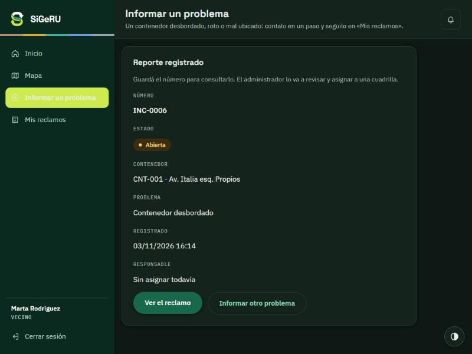

*CP-UI-01: el vecino recibe el número INC-0006, abierta y sin responsable.*

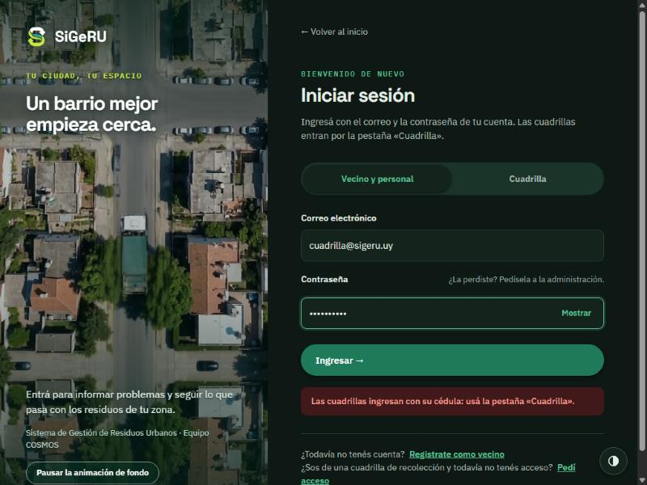

*CP-UI-02: con el correo, la cuenta de cuadrilla recibe el mensaje que la manda a la pestaña «Cuadrilla».*

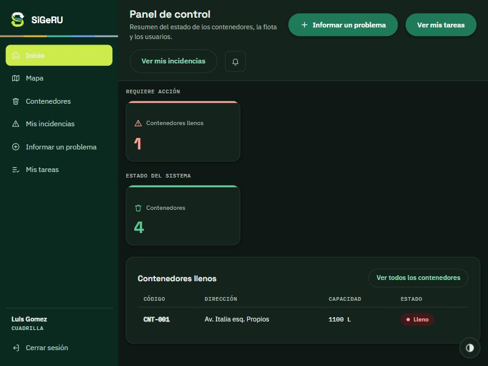

*CP-UI-02: con la cédula 4.100.001-9 entra Luis Gómez, rol Cuadrilla. Se ve CNT-001 «lleno» por el desborde del caso anterior.*

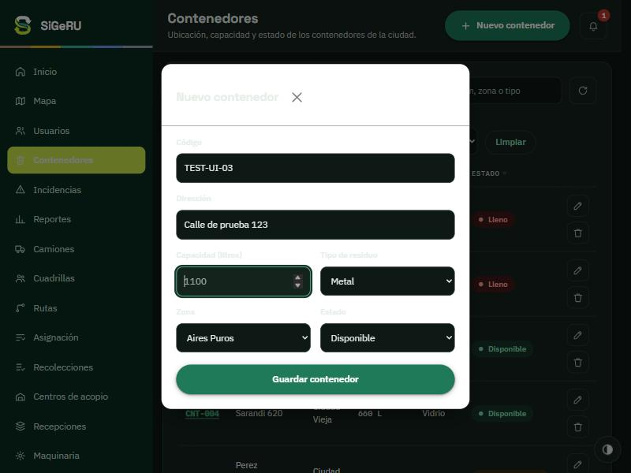

*CP-UI-03, primera vez: se escribió `abc` y el campo capacidad siguió vacío, sin ningún aviso (DEF-16).*

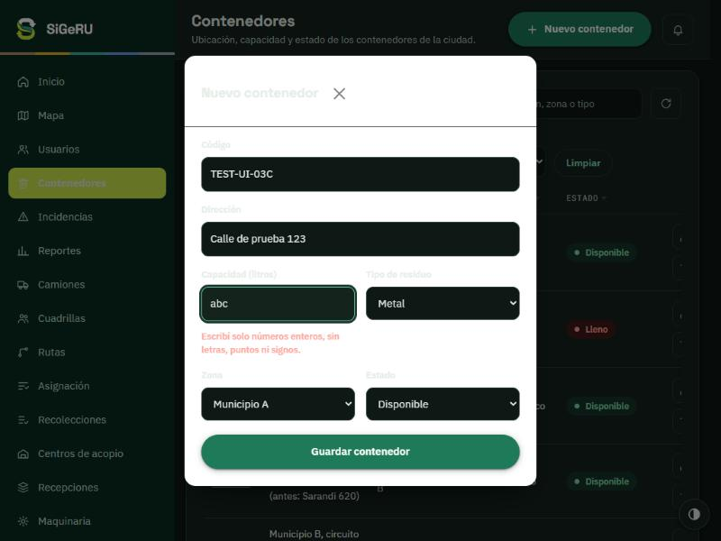

*CP-UI-03, repetido con el arreglo: con `abc` el campo se marca con un mensaje y no se crea el contenedor.*

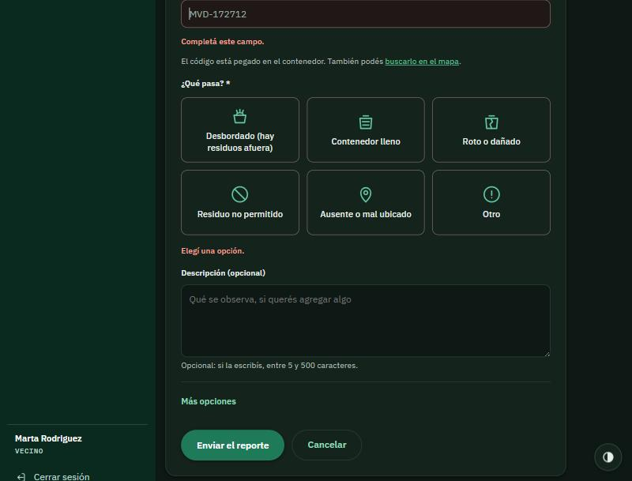

*CP-UI-04: con Enter y el formulario vacío, el foco va al código y se marcan los campos que faltan.*

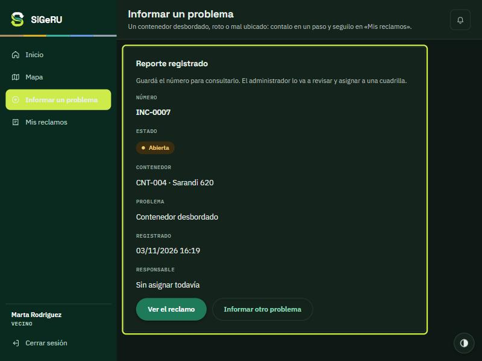

*CP-UI-04: completado solo con el teclado, el reporte INC-0007 queda registrado y el foco pasa al panel de confirmación.*

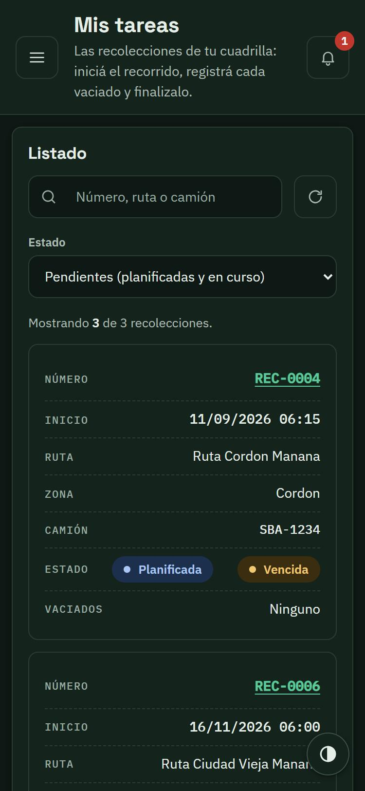

*CP-UI-06: «Mis tareas» a 375 px (simulado). Las filas pasan a tarjetas y no hay desplazamiento horizontal.*

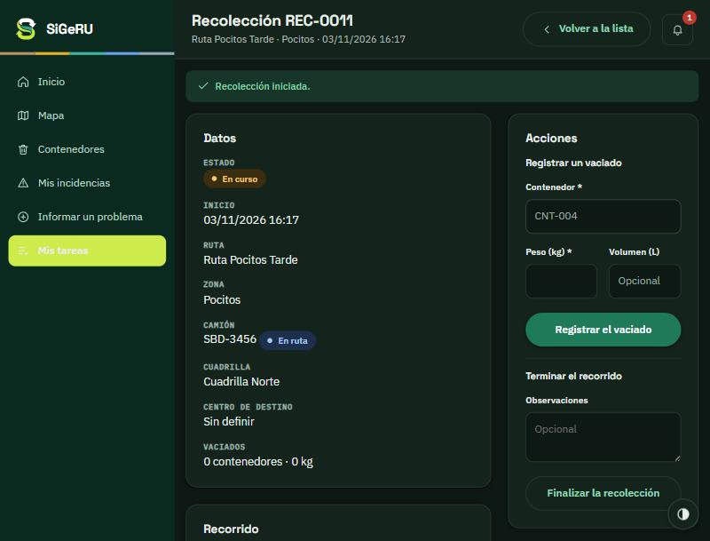

*CP-UI-07: la cuadrilla inició la recolección REC-0011; el camión SBD-3456 pasó a «en ruta».*

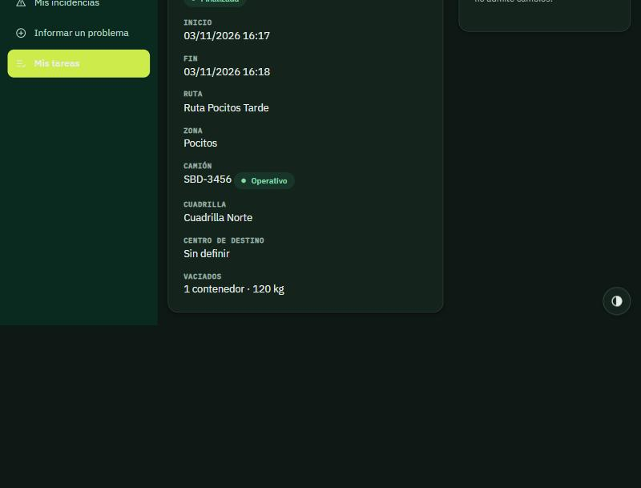

*CP-UI-07: al finalizar, la recolección tiene hora de fin y el camión vuelve a «operativo».*

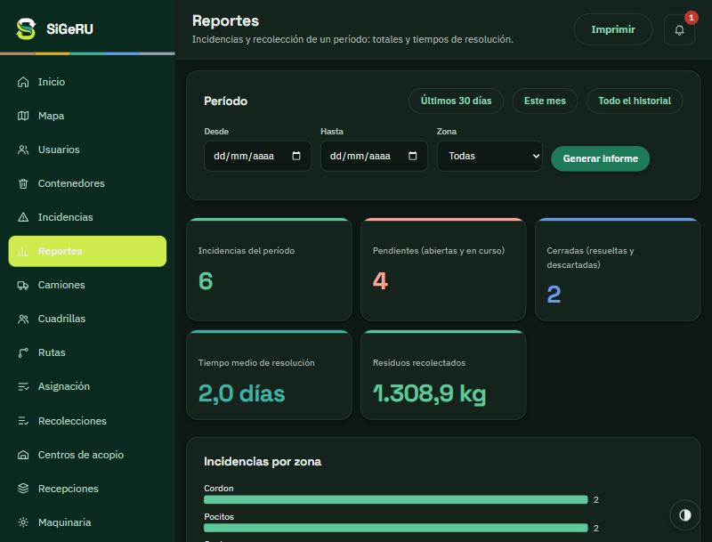

*CP-UI-08: el informe muestra 6 incidencias, 4 pendientes y 2 cerradas, igual que el listado. Arriba a la derecha solo había «Imprimir»: no había exportación a CSV (DEF-17).*

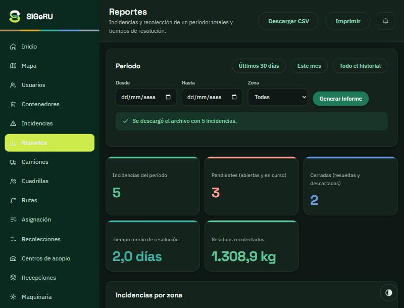

*CP-UI-08, repetido con el arreglo: aparece «Descargar CSV» y el aviso «Se descargó el archivo con 5 incidencias» (esta captura es del seed de defensa, que tiene 5 incidencias).*

## Ficha para los casos a mano

Esta ficha es para lo que sigue pendiente: CP-UI-05 (Firefox), la prueba en un celular real y la repetición de dos o tres casos por integrantes del equipo para que haya revisión cruzada de verdad. Se completa una ficha por caso; se puede copiar la tabla o imprimirla. Los casos que ya ejecutó la IA el 03/11 tienen sus propias capturas con el nombre `CP-UI-NN_2026-11-03_...`.

| Campo | Completar |
|---|---|
| Código del caso | |
| Fecha y hora | |
| Quién lo ejecutó | |
| Navegador y versión | |
| Tamaño de pantalla | |
| Cuenta usada | |
| Pasos que se hicieron | |
| Resultado obtenido | |
| Estado (aprobado, fallido, bloqueado) | |
| Nombre de la captura | |
| Defecto (si falló) | |
| Quién lo revisó | |

Las capturas van en `ingenieria-software/testing-3ra/evidencia/` con el nombre `CP-UI-01_2026-11-04_equipo.jpg`. En la captura se tiene que ver la fecha y la hora de la computadora.

## Resultados de la corrida

<!-- resultados:inicio -->
Estos números no se escriben a mano: los cuenta el generador del PDF leyendo la salida completa de cada corrida, que está guardada sin cambios en `ingenieria-software/testing-3ra/evidencia/`. Si se vuelven a correr las pruebas, se guarda la salida nueva y se vuelve a generar el documento.

| Pruebas | Archivo de la salida | Fecha y hora | Pasaron | Fallaron | Omitidas |
|---|---|---|---|---|---|
| Unitarias (sin base ni servidor) | unitarias-20261106-1035.txt | 06/11/2026 10:35 | 677 | 0 | 0 |
| De integración (HTTP contra las APIs y la base) | http-20261103-1633.txt | 03/11/2026 16:33 | 969 | 0 | 0 |
| **Total** | | | **1646** | **0** | **0** |

**Entorno de la corrida** (archivo entorno-20261103-1632.txt):

- Corrida del 03/11/2026 despues de arreglar DEF-16 y DEF-17 (unitarias 16:32, HTTP 16:33)
- PHP: PHP 8.2.33 (cli) (built: Jul 28 2026 10:27:30) (NTS Visual C++ 2019 x64)
- Base: MariaDB 10.4.32-MariaDB
- Tablas en la base sigeru: 25
- Commit: 7c780d5 (mas los cambios sin commitear, incluidos los dos arreglos)
- Datos cargados: seed de pruebas (database/datos_prueba.sql) con restaurar-base-demo.cmd
- Cobertura de lineas: no medida (php -m no muestra xdebug ni pcov)

### Detalle de las pruebas unitarias por sección

El nombre de cada sección es el que imprime el corredor. Algunos números se repiten porque cada archivo numera sus secciones por su cuenta (DEF-14).

| Sección | Pasaron | Fallaron | Omitidas |
|---|---|---|---|
| 1. Migraciones: dividir un archivo en sentencias | 7 | 0 | 0 |
| 2. Migraciones: nombres de archivo | 7 | 0 | 0 |
| 3. Migraciones: registro en schema.sql | 5 | 0 | 0 |
| 4. Front: copias compartidas entre landing y frontend-usuarios | 6 | 0 | 0 |
| 5. Front: sin dependencias de internet ni entre aplicaciones | 5 | 0 | 0 |
| 5b. Landing: datos reales, mapa publico y promesas honestas | 5 | 0 | 0 |
| 6. Front: un solo menu y base compartida | 7 | 0 | 0 |
| 7. Login: politica de bloqueo por intentos | 8 | 0 | 0 |
| 8. Permisos: la tabla, el router, el menu y las copias | 21 | 0 | 0 |
| 9. Incidencias: el flujo de estados | 13 | 0 | 0 |
| 10. Incidencias: quien ve y toca cada una | 14 | 0 | 0 |
| 11. Incidencias: lo que le pasa al contenedor | 7 | 0 | 0 |
| 12. Incidencias: validacion de lo que llega | 23 | 0 | 0 |
| 13. Incidencias: filtros del listado | 10 | 0 | 0 |
| 14. Incidencias: permisos y consistencia con la base | 21 | 0 | 0 |
| 15. Recolecciones: el flujo de estados | 5 | 0 | 0 |
| 16. Recolecciones: quien alcanza cada una y el camion | 4 | 0 | 0 |
| 17. Recolecciones: validacion de lo que llega | 13 | 0 | 0 |
| 18. Recolecciones: filtros y consistencia con la base | 4 | 0 | 0 |
| 10. Estadisticas: matematica basica | 15 | 0 | 0 |
| 11. Estadisticas: informe de incidencias de un periodo | 14 | 0 | 0 |
| 12. Estadisticas: panel por urgencias | 16 | 0 | 0 |
| 13. Estadisticas: resumen de lo recolectado | 6 | 0 | 0 |
| 14. Listas: paginacion y busqueda | 25 | 0 | 0 |
| 15. Listas: filtros de usuarios y de contenedores | 11 | 0 | 0 |
| 16. Contenedores: validacion de los datos | 30 | 0 | 0 |
| 17. Listas: pantallas que filtran y paginan en el servidor | 4 | 0 | 0 |
| 18. Validacion de centros, maquinaria y camiones | 26 | 0 | 0 |
| 19. Clave de prueba del seed | 6 | 0 | 0 |
| 20. Accesibilidad: estructura de cada pagina | 3 | 0 | 0 |
| 22. Seguridad: auditoria y codigo compartido | 43 | 0 | 0 |
| 26. Operario: stock del centro (calculos puros) | 48 | 0 | 0 |
| 26 bis. Operario: lineas de una recepcion | 12 | 0 | 0 |
| 26 ter. Operario: alcance por centro | 9 | 0 | 0 |
| 26 quater. Operario: matriz de permisos nueva | 16 | 0 | 0 |
| 28. Avisos: textos de cada evento | 11 | 0 | 0 |
| 28 bis. Avisos: copias identicas | 1 | 0 | 0 |
| 47. Rutas: topes y esquema | 7 | 0 | 0 |
| 48. Trazado: firma, polilinea, tramos y calidad | 16 | 0 | 0 |
| 48 bis. Trazado: la cascada de servicios con respuestas simuladas | 15 | 0 | 0 |
| 49. Paradas de una ruta: forma del pedido | 13 | 0 | 0 |
| 51. Prioridad de contenedores y de rutas | 18 | 0 | 0 |
| 51 bis. Asignacion sugerida de cuadrillas y camiones | 13 | 0 | 0 |
| 51 ter. Sugerencia por municipio y turno | 20 | 0 | 0 |
| 45. Tema claro y oscuro: contraste AA | 5 | 0 | 0 |
| 45 bis. Tema: tokens definidos, interruptor y paginas | 6 | 0 | 0 |
| 46. Pulido: errores, imagen para compartir, estados vacios e impresion | 8 | 0 | 0 |
| 52. QR de los contenedores: el login vuelve a donde estaba | 7 | 0 | 0 |
| 52 bis. Hallazgos de la evaluación heurística arreglados (23/10/2026) | 4 | 0 | 0 |
| 53. Compatibilidad con PHP 8.0 y hora de Uruguay | 8 | 0 | 0 |
| 9. Cedula: validacion y formato | 21 | 0 | 0 |
| 9b. Cedula: esquema, migracion, semillas y pantallas | 22 | 0 | 0 |
| 54. Capacidad del contenedor (DEF-16) y descarga del informe en CSV (DEF-17) | 13 | 0 | 0 |

### Detalle de las pruebas de integración (HTTP) por sección

El nombre de cada sección es el que imprime el corredor. Algunos números se repiten porque cada archivo numera sus secciones por su cuenta (DEF-14).

| Sección | Pasaron | Fallaron | Omitidas |
|---|---|---|---|
| 0. El entorno esta levantado | 3 | 0 | 0 |
| 1. Control de acceso | 8 | 0 | 0 |
| 2. Alta valida | 5 | 0 | 0 |
| 3. Alta duplicada | 3 | 0 | 0 |
| 4. Validaciones | 9 | 0 | 0 |
| 5. Baja logica | 4 | 0 | 0 |
| 6. Maquinaria de los centros de acopio | 12 | 0 | 0 |
| 7. Solicitudes de registro | 10 | 0 | 0 |
| 7b. Contrasena que define el administrador | 19 | 0 | 0 |
| 8. Matriz de permisos por rol | 46 | 0 | 0 |
| 9. Limite de intentos de login y estado de la cuenta | 12 | 0 | 0 |
| 10. Cabeceras y archivos que no se sirven | 28 | 0 | 0 |
| 11. Incidencias: matriz de permisos | 10 | 0 | 0 |
| 12. Incidencias: registrar y validar | 24 | 0 | 0 |
| 13. Incidencias: quien ve cada una y los filtros | 22 | 0 | 0 |
| 14. Incidencias: prioridad y asignacion | 26 | 0 | 0 |
| 15. Incidencias: el trabajo de la cuadrilla | 26 | 0 | 0 |
| 16. Incidencias: el contenedor se libera solo cuando no queda nada abierto | 11 | 0 | 0 |
| 17. Estado del contenedor: un solo camino, con asiento y sin duplicados | 9 | 0 | 0 |
| 19. Recolecciones: matriz de permisos | 9 | 0 | 0 |
| 20. Rutas | 9 | 0 | 0 |
| 21. Recolecciones: planificar, iniciar, vaciar y finalizar | 41 | 0 | 0 |
| 22. Recolecciones: limpieza y datos del seed intactos | 3 | 0 | 0 |
| 24. Operario: preparar los datos de prueba | 2 | 0 | 0 |
| 24 bis. Operario: quien puede y a que centro llega | 23 | 0 | 0 |
| 25. Operario: recibir lo que trae una recoleccion | 25 | 0 | 0 |
| 26 quinquies. Operario: retiros y correcciones | 21 | 0 | 0 |
| 26 sexies. Operario: aviso del 80 %, resumen e historial | 12 | 0 | 0 |
| 27. Operario: estado de la maquinaria con historial | 20 | 0 | 0 |
| 27 bis. Operario: asignar el centro desde Usuarios | 9 | 0 | 0 |
| 27 ter. Operario: limpieza y datos del seed intactos | 3 | 0 | 0 |
| 29. Avisos: preparar los datos de prueba | 3 | 0 | 0 |
| 29 bis. Avisos: limites de la lista | 4 | 0 | 0 |
| 29 ter. Avisos: una incidencia mueve los avisos de cada persona | 10 | 0 | 0 |
| 29 quater. Avisos: leer, marcar y que cada uno vea solo los suyos | 11 | 0 | 0 |
| 29 quinquies. Avisos: resolver, descartar y textos largos | 4 | 0 | 0 |
| 29 sexies. Avisos: recolecciones y centros de acopio | 7 | 0 | 0 |
| 29 septies. Avisos: limpieza y datos del seed intactos | 1 | 0 | 0 |
| 47. Tope de contenedores por zona (municipio) | 13 | 0 | 0 |
| 48. Rutas con contenedores: permisos y validaciones | 10 | 0 | 0 |
| 48 bis. Rutas con contenedores: guardar, ordenar y mover | 14 | 0 | 0 |
| 48 ter. Rutas con contenedores: inactivas, recolecciones en curso, cambio de zona y avisos | 10 | 0 | 0 |
| 48 quater. Rutas con contenedores: trazado y borrado | 10 | 0 | 0 |
| 50. Rutas en el mapa: permisos y respuesta | 10 | 0 | 0 |
| 52. Asignacion de rutas: permisos y validaciones | 15 | 0 | 0 |
| 52 bis. Asignacion de rutas: el dia, la prioridad y la sugerencia | 6 | 0 | 0 |
| 52 bis 2. La sugerencia empareja cada ruta con la cuadrilla de su municipio (parte 26) | 4 | 0 | 0 |
| 52 ter. Asignacion de rutas: el lote, todas o ninguna | 7 | 0 | 0 |
| 52 quater. Mis rutas y lo que ve la cuadrilla | 16 | 0 | 0 |
| 46. Incidencias: prioridad por tipo, lleno, roto y derivacion a mantenimiento | 32 | 0 | 0 |
| 47. Cuadrillas: alta, edicion, baja y matriz de permisos | 37 | 0 | 0 |
| 48. Usuarios: la cuadrilla de un usuario con rol Cuadrilla | 31 | 0 | 0 |
| 49. Registro y pedidos de acceso: nadie se hace cuadrilla solo | 30 | 0 | 0 |
| 46h. Paginas de error amables | 9 | 0 | 0 |
| 22b. Estadisticas: permisos | 7 | 0 | 0 |
| 22c. Estadisticas: validaciones del periodo | 16 | 0 | 0 |
| 22d. Estadisticas: las cifras coinciden con las listas | 29 | 0 | 0 |
| 22e. Datos publicos de la landing | 16 | 0 | 0 |
| 22f. Contenedores: ya no hay valores por omision silenciosos | 19 | 0 | 0 |
| 22g. Listas: filtros y paginacion en el servidor | 31 | 0 | 0 |
| 22h. Centros, maquinaria y camiones: datos validados | 19 | 0 | 0 |
| 22j. Seguridad: cabeceras, sesion y exposicion | 28 | 0 | 0 |
| 22k. Auditoria: quien hizo que | 26 | 0 | 0 |
| 22l. Seguridad: inyeccion SQL | 10 | 0 | 0 |
| 22m. Seguridad: freno a los pedidos publicos | 7 | 0 | 0 |
| 23. Limpieza | 3 | 0 | 0 |
<!-- resultados:fin -->

## Matriz de trazabilidad

La matriz une cada requisito de la especificación con su caso de uso, el caso de prueba y el resultado. La columna «Prueba automática» dice en qué sección de la salida de hoy está.

| Requisito | Caso de uso | Caso de prueba | Prueba automática | Resultado |
|---|---|---|---|---|
| RF-001, RF-010, RF-181 | CU-003, CU-005 | CP-ACC-09 a 11 | HTTP 7, 7b, 49 | Aprobado |
| RF-002, RF-177, RF-178 | CU-001 | CP-ACC-01 a 06 | HTTP 1, 4, 9, 48 | Aprobado |
| RF-003 | CU-002 | CP-ACC-07 | HTTP 22j | Aprobado |
| RF-006, RF-007, RF-011, RF-012 | CU-006 a CU-011 | CP-ACC-08 | HTTP 2 a 5, 22g, 48 | Aprobado |
| RF-008, RF-009, RF-166, RNF-002 | CU-004 | Tabla de decisión | Unitarias 8, 14; HTTP 8, 11, 19 | Aprobado |
| RF-013 a RF-019, RF-183 a RF-186 | CU-012 a CU-015 | CP-CON-01 a 16 | Unitarias 16; HTTP 2 a 5, 22f, 47 | Aprobado |
| RF-028 a RF-032, RF-101 | CU-016 a CU-019 | CP-REC-07 | HTTP 2 a 5, 21, 22h | Aprobado |
| RF-080 a RF-083, RF-088, RF-187, RF-189 | CU-020, CU-021 | CP-OPE-01 a 03 | HTTP 8, 22h, 24 a 26 sexies | Aprobado |
| RF-246 a RF-255 | CU-031, CU-032 | CP-OPE-04, 05 | HTTP 6, 27 | Aprobado |
| RF-147, RF-148, RF-190, RF-211 | CU-022 | CP-CON-11 | HTTP 8, 22f | Aprobado (solo permisos y tipo inexistente) |
| RF-217 a RF-221 | CU-023 | CP-INC-01 a 07 | HTTP 12 | Aprobado |
| RF-224 a RF-228 | CU-025 | CP-INC-08, 09 | HTTP 13, 14 | Aprobado |
| RF-229 a RF-231, RF-238 a RF-241 | CU-026, CU-028 | CP-INC-10 a 14 | HTTP 13, 15 | Aprobado |
| RF-232 a RF-236, RNF-016, RNF-017 | CU-027 | CP-INC-13, 15 | HTTP 16, 17; unitarias 11, 14 | Aprobado |
| RF-242 a RF-244 | CU-030 | CP-PUB-03, CP-UI-08 | HTTP 22b a 22d | Aprobado (también a mano: las cifras coinciden) |
| RF-245 (exportar) | CU-030 | CP-UI-08 | Unitarias 54 | Aprobado en CSV desde el 03/11 (DEF-17); PDF no existe |
| RF-257, RF-258 | — | CP-REC-01 a 06, CP-RUT-01 a 06 | HTTP 19 a 22, 47 a 52 quater | Aprobado |
| RF-259 a RF-263 (mapa y panel) | — | CP-PUB-01, CP-UI-06 | HTTP 22b, 22e, 50 | Aprobado (el mapa también se vio a 375 px) |
| RF-158 a RF-162 | — | CP-PUB-01, 02, CP-SEG-03 | HTTP 10, 22e | Aprobado |
| RF-163 a RF-171 (pantallas) | Varios | CP-UI-01 a 04, 07 | Unitarias 8, 20, 54 | Aprobado a mano por la IA; falta la repetición del equipo |
| RF-222, RF-223 (foto) | CU-024 | — | — | Retirado el 30/10: no se prueba |
| RF-026, RF-027, RF-103, RF-191 (repuestos) | CU-029 | — | — | No implementado |
| RF-216, RNF-006 (idioma) | — | — | — | No implementado |
| RNF-007 (tiempos de respuesta) | — | — | — | Sin medir: no hicimos prueba de carga |
| RNF-009 (navegadores) | — | CP-UI-05 | — | Bloqueado: solo se probó en Chromium |
| RNF-014 (pruebas unitarias) | — | Todo este plan | 663 unitarias | Aprobado |

Hay requisitos que no tienen caso de uso directo (la especificación los cuenta: son 22). Los de rutas y recolecciones (RF-257 y RF-258) son un ejemplo: tienen prueba, pero ningún CU los describe todavía.

## Bitácora de defectos

Acá están los errores que encontramos al probar y cómo los arreglamos. Cada uno dice cómo se encontró, qué tan grave era, la causa, el arreglo y qué prueba lo cubre ahora para que no vuelva. Los sacamos del checklist y del registro del proyecto, donde quedaron anotados el día que pasaron.

**Severidad:** alta = deja datos mal, abre un agujero de seguridad o impide trabajar; media = molesta o confunde pero se puede seguir; baja = estética.

| Código | Fecha | Qué pasaba | Severidad | Estado |
|---|---|---|---|---|
| DEF-01 | 12/10 | La tabla `vaciado` de la base estaba rota y MySQL arrancaba con recuperación de caída. | Alta | Cerrado |
| DEF-02 | 12/10 | Pedir `/sigeru/tests/correr-tests.php` desde el navegador ejecutaba toda la suite dentro del servidor, y se llamaba a sí misma en bucle. | Alta | Cerrado |
| DEF-03 | 12/10 | Contenedores y camiones se podían leer sin iniciar sesión. En septiembre lo habíamos decidido así, pero al revisar los permisos vimos que no correspondía. | Alta | Cerrado |
| DEF-04 | 12/10 | Si una prueba fallaba a la mitad, la suite se cortaba con un error fatal y dejaba datos de prueba en la base. | Media | Cerrado |
| DEF-05 | 14/10 | La cuadrilla veía el nombre y el id del vecino que informó la incidencia en el historial. | Alta (privacidad) | Cerrado |
| DEF-06 | 14/10 | A 375 px el detalle de la incidencia se salía 100 px de la pantalla. | Baja | Cerrado |
| DEF-07 | 14/10 | El cuadro de «Planificar recolección» se salía de la pantalla. | Baja | Cerrado |
| DEF-08 | 14/10 | El cuadro de confirmación pintaba de rojo acciones positivas («Marcar como resuelta») y no ponía el foco en ningún botón. | Media (accesibilidad) | Cerrado |
| DEF-09 | 23/10 | La pantalla «Asignación» no cargaba nada. | Alta | Cerrado |
| DEF-10 | 23/10 | El formulario de incidencias mandaba siempre prioridad «media» y anulaba la regla por tipo (un desborde tiene que ser alta). | Alta | Cerrado |
| DEF-11 | 24/10 | «Armar ruta» y «Asignación» se habrían roto en el servidor Rocky. | Alta | Cerrado |
| DEF-12 | 12/10 a 24/10 | El PHP de Apache usaba la hora de Alemania y el de la consola la de Uruguay. | Media | Cerrado |
| DEF-13 | 03/11 | En la corrida de hoy aparece el mensaje «no se pudo guardar un aviso» (clave foránea `fk_notificacion_usuario`) en la parte «29 quinquies» de la salida. Las pruebas pasan. | Baja | Abierto |
| DEF-14 | 03/11 | En la salida de las unitarias se repiten números de sección (hay dos «10», dos «11», etc.). | Baja | Abierto |
| DEF-15 | 03/11 | No hay prueba para la capacidad 1 (borde de abajo) ni para la latitud 90 y 91. | Baja | Abierto |
| DEF-16 | 03/11 | En «Nuevo contenedor», si se escribía `abc` en la capacidad, el navegador no dejaba ingresar las letras y el campo quedaba vacío sin avisar; el contenedor se guardaba sin capacidad. | Media | Cerrado |
| DEF-17 | 03/11 | La pantalla Reportes no tenía exportación a CSV, que la especificación (RF-245) y la versión 1.0 de este plan daban por existente. Solo había «Imprimir». | Media | Cerrado |
| DEF-18 | 03/11 | A 375 px el botón flotante del tema claro y oscuro tapa un poco de texto al final de algunas pantallas. | Baja | Abierto |

Y esta es la causa de cada uno, cómo lo arreglamos y qué prueba lo cubre para que no vuelva:

| Código | Cómo se encontró | Causa y arreglo | Prueba que lo cubre ahora |
|---|---|---|---|
| DEF-01 | Revisando el registro de errores de MySQL. | El script de apagado decía «Listo» antes de que MySQL terminara de escribir, y se sacaba el pendrive. Ahora espera a que MySQL termine. Se agregó `restaurar-base-demo.cmd`. | Prueba a mano del ciclo de apagado (12/10). |
| DEF-02 | Al probar qué archivos se publicaban. | Apache publicaba todo el repositorio. Se puso una lista blanca: solo se sirven la landing, el frontend y las APIs. | HTTP 10: «No se sirve /tests/correr-tests.php». |
| DEF-03 | Revisando los permisos de lectura. | Faltaba controlar las lecturas. Se hizo una tabla única de permisos con denegación por defecto. | Unitarias 8; HTTP 1 y 8. |
| DEF-04 | Al correr las pruebas de incidencias. | Un `end()` sobre un valor nulo. Se corrigió y la suite ahora borra al empezar los restos de una corrida anterior. | La propia suite (sección 23, limpieza). |
| DEF-05 | Probando el detalle con la cuenta de cuadrilla. | La API mandaba el historial completo. `historialVisible()` ahora lo oculta a quien no es administrador. | Unitarias 10; HTTP 15. |
| DEF-06 | Revisando a ancho de celular. | La lista de cuadrillas no se ajustaba. Se corrigió el CSS. | Revisión a mano a 375 px. |
| DEF-07 | Revisando a ancho de celular. | Opciones con textos largos. Se corrigió el CSS. | Revisión a mano. |
| DEF-08 | Probando con teclado. | Se usaba el mismo estilo para todo. Ahora enfoca «Cancelar» y usa rojo solo para lo que borra. Corregido el 17/10. | Revisión a mano. |
| DEF-09 | Recorriendo el sistema con el equipo. | `asignacion.js` tenía una función `opciones()` con el mismo nombre que otra de `api.js`, y la pisaba. Se renombró a `opcionesSelect`. | Revisión en el navegador. |
| DEF-10 | Evaluación heurística de la interfaz (H-01). | El campo arrancaba en «Media». Ahora arranca vacío y la prioridad la pone el servidor según el tipo. | Unitarias 52 bis; HTTP 46. |
| DEF-11 | Revisando la versión de PHP del servidor. | El código usaba `array_is_list`, que existe desde PHP 8.1, y Rocky trae 8.0. Se reemplazó, y una prueba impide usar funciones nuevas. | Unitarias 53. |
| DEF-12 | Comparando fechas guardadas. | Faltaba fijar la zona horaria. Las tres APIs fijan `America/Montevideo` y la base `-03:00`. | Unitarias 53. |
| DEF-13 | Leyendo la salida completa de la corrida HTTP. | El sistema intenta avisarle a un usuario que ya no existe (probablemente uno de prueba borrado). El error se captura y no rompe nada. Falta ver por qué se intenta. | HTTP 29 quinquies. |
| DEF-14 | Leyendo la salida para este plan. | Cada archivo numera sus secciones por su cuenta. No afecta el resultado, pero confunde al citar. Por eso en este plan citamos la sección por número y nombre. | — |
| DEF-15 | Al armar la tabla de valores límite de este plan. | Las pruebas tomaron valores lejos del borde. El código parece correcto (`< 1` y `abs() > 90`), pero no está comprobado. Falta agregar las pruebas. | — |
| DEF-16 | CP-UI-03, al dar de alta un contenedor desde la pantalla. | La capacidad es opcional (un vacío significa «sin dato») y el campo era de tipo número, así que el navegador descartaba las letras. Ahora es de texto con teclado numérico y solo acepta dígitos (`inputmode="numeric"`, `pattern="[0-9]+"`), con mensaje propio; el servidor sigue validando el rango de 1 a 100000. Arreglado el 03/11 en `contenedores.html` y `formularios.js`. | Unitarias 54; CP-UI-03 repetido. |
| DEF-17 | CP-UI-08, buscando el botón de exportar. | Búsqueda de «csv» en `frontend-usuarios` y `api-gestion`: cero resultados. Se agregó el botón «Descargar CSV» en Reportes (`js/csv.js` y `js/reportes.js`): baja el detalle de incidencias del período en pantalla, con `;`, UTF-8 con marca de orden de bytes, comillas escapadas, texto que empieza con `=`, `+`, `-` o `@` protegido y coma decimal en las horas. Arreglado el 03/11. La exportación a PDF sigue sin existir. | Unitarias 54; CP-UI-08 repetido. |
| DEF-18 | CP-UI-06, viendo las capturas a 375 px. | El botón está fijo abajo a la derecha y se superpone al contenido. No impide usar la pantalla. | CP-UI-06. |

## Material consultado

Borba, G. (2026). *Testing de software: material de clase* [Material de clase no publicado]. Escuela Superior de Informática, UTU. [Verificar la cita exacta]

DGETP-UTU. (2026). *Proyecto de pasaje de grado 2026: letra del proyecto*. Escuela Superior de Informática.

IEEE. (1998). *IEEE standard for software test documentation* (IEEE Std 829-1998). Institute of Electrical and Electronics Engineers.

Myers, G. J., Sandler, C., & Badgett, T. (2011). *The art of software testing* (3.ª ed.). John Wiley & Sons.

Equipo COSMOS. (2026). *Especificación de requisitos de SiGeRU, versión 2.1* [Documento interno]. Escuela Superior de Informática.
