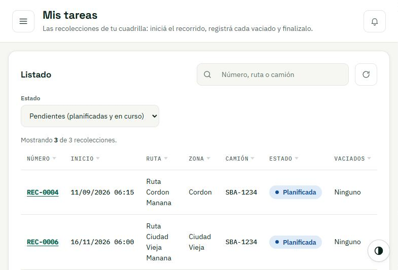

# Manual de la Cuadrilla

**Para qué sirve.** La cuadrilla ve **solo lo que le asignaron**: las incidencias que la administración le encargó y las recolecciones
de su cuadrilla. Desde acá registra el avance de cada trabajo, lo cierra, y anota cada contenedor que vacía con su peso.

## 1. Entrar

Desde la página de SiGeRU, **Ingresar** con el correo y la contraseña que te dio la administración. Si la perdiste, la
administración te define una nueva (no hay «Olvidé mi contraseña»). Tu cuenta tiene que estar vinculada a una cuadrilla (lo hace la administración); si no lo está, no vas a ver incidencias ni recolecciones.
Menú: **Inicio**, **Mapa**, **Contenedores**, **Mis incidencias** y **Mis tareas**. La sesión se cierra sola tras 2 horas sin uso.

## 2. Mis incidencias

**Mis incidencias** lista lo asignado a tu cuadrilla, con número, contenedor, dirección, tipo, prioridad, estado y fecha. Podés
buscar y filtrar por estado.

1. Tocá el número (por ejemplo `INC-0003`) para abrir el detalle: datos, descripción, **foto** (si el vecino adjuntó una) e **historial**.
2. **Registrar un avance:** escribí **Qué se hizo hasta ahora** (por ejemplo, «se pidió una tapa al depósito») y tocá **Registrar el avance**.
   El texto es obligatorio (hasta 300 caracteres) y queda firmado con tu nombre y la hora.
3. **Cerrar como resuelta:** cuando el problema está solucionado, escribí **Qué se hizo** (opcional) y tocá **Marcar como resuelta**.
   El contenedor vuelve a «disponible» si no quedan otros problemas abiertos en él.

Lo que **no** podés hacer: asignar a otra cuadrilla, cambiar la prioridad ni descartar (es de la administración). No ves quién
informó el problema, solo que lo informó un vecino.

## 3. Mis tareas (recolecciones)

*Mis tareas: las recolecciones de la cuadrilla*

**Mis tareas** muestra las recolecciones de tu cuadrilla, con estado: **Planificada**, **En curso**, **Finalizada**, **Cancelada**.
Tocá una para abrirla: ruta, camión, cuadrilla, centro de destino, inicio previsto y la tabla de **Vaciados**.

1. **Salir a recolectar:** tocá **Iniciar la recolección**. El camión pasa a «en ruta».
2. **Registrar un vaciado,** por cada contenedor que vaciás: **Contenedor** (el código, por ejemplo `CNT-004`), **Peso (kg)**
   (obligatorio, mayor que 0 y hasta 5000) y **Volumen (L)** (opcional, no puede superar la capacidad del contenedor). Tocá
   **Registrar el vaciado**. Cada vaciado queda con su hora.
3. **Terminar el recorrido:** tocá **Finalizar la recolección** (podés agregar **Observaciones**). Se registra la hora de fin, el camión vuelve
   a «operativo» y ya no se pueden agregar vaciados.

Cancelar una recolección lo hace la administración. Si abrís una recolección de otra cuadrilla, el sistema dice que no la encuentra.

## 4. Mapa y contenedores

**Mapa** muestra los contenedores y las incidencias abiertas que te tocan. **Contenedores** lista los contenedores; al abrir uno se ve
su **ficha** con el historial de sus estados (disponible, lleno, mantenimiento, retirado).

## Avisos (la campanita)

La **campanita** de arriba a la derecha te muestra, con un número, lo que todavía no leíste: cuando el administrador **les asigna una incidencia** y cuando
**planifica una recolección** para tu cuadrilla. Tocá un aviso para ir directo a la incidencia o a la recolección; **Marcar todos como leídos** limpia el contador.
Se actualiza sola cada minuto. Cada persona de la cuadrilla recibe los avisos de su cuadrilla.

## 5. Problemas frecuentes

- **«Esa recolección no es de tu cuadrilla»:** abrila desde **Mis tareas**; solo ves las propias.
- **El peso no se acepta:** tiene que ser un número mayor que 0 y de hasta 5000 kg; usá punto o coma decimal según tu teclado.
- **No puedo iniciar:** la recolección tiene que estar «Planificada» y el camión disponible; si el camión está en mantenimiento, avisá a la administración.
