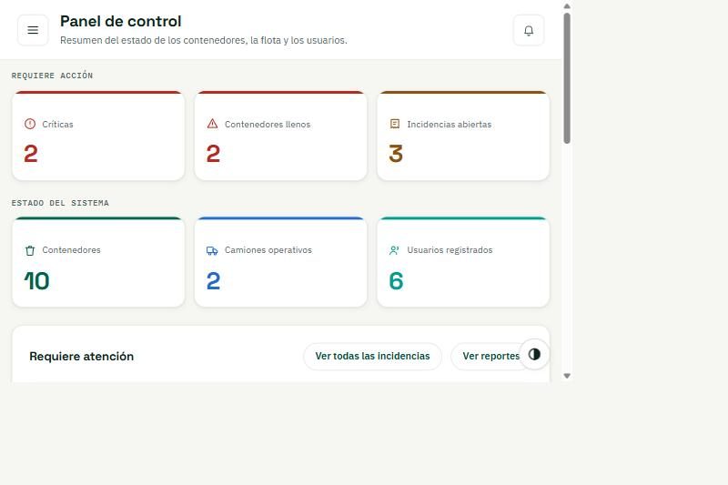

# Manual del Administrador

**Para qué sirve.** El administrador tiene acceso a todo el sistema: usuarios, contenedores, incidencias, flota, rutas, recolecciones,
centros, maquinaria, reportes y auditoría.

## 1. Entrar y panel

*Panel de control del administrador. Captura del 19/10/2026 con datos de demostración.*

**Ingresar** con correo y contraseña. **Inicio** (Panel de control) muestra el bloque **Requiere atención**, con las incidencias urgentes
calculadas al momento. Tras 2 horas sin actividad la sesión se cierra.

## 2. Usuarios

**Usuarios** lista las cuentas. Podés buscar y filtrar por **Rol** (Administrador, Operario, Cuadrilla, Vecino) y **Estado** (Activo,
Dado de baja); **Limpiar** borra los filtros. Esta lista no tiene descarga CSV en la versión actual.

- **Alta:** botón de nuevo usuario, completar Nombre, Apellido, Email, **Contraseña** (8 caracteres o más) y rol, **Guardar usuario**. Si el rol es Cuadrilla, también tenés que indicar una cédula válida y la cuadrilla a la que pertenece. La cuenta queda activa y le entregás la contraseña a la persona en mano: el sistema no manda correo.
- **Contraseña perdida:** **Editar** el usuario y escribir una **Contraseña** nueva (vacía no se cambia). No hay «Olvidé mi contraseña»: la restablece la administración.
- **Centro del Operario:** al elegir el rol Operario aparece **Centro de acopio**. Un Operario solo ve y mueve el centro que le asignes; sin
  centro no puede operar (la lista muestra «Operario · nombre del centro»).
- **Editar:** lápiz de la fila, **Guardar cambios**. **Dar de baja:** pide confirmación.

## 3. Solicitudes de acceso

**Solicitudes de acceso** tiene las pestañas Pendientes, Todas, Aprobadas y Rechazadas. **Aprobar** pide una contraseña inicial y el **Rol con el que entra**. Si la solicitud es de Cuadrilla, revisá la cédula y elegí la cuadrilla real: no se puede aprobar con otro rol. Después tocá **Aprobar y crear la cuenta**. **Rechazar** cierra la solicitud. Los vecinos también pueden registrarse solos, sin pasar por esta pantalla.

## 4. Contenedores

**Contenedores**: alta y edición con Código, Dirección, Zona, Tipo de residuo, Capacidad (litros) y Estado. Cada contenedor tiene una
ficha con su historial. Dar de baja pide confirmación.

## 5. Incidencias

**Incidencias** lista con filtros Estado (Abierta, En curso, Resuelta, Descartada), Zona, Desde y Hasta. Al abrir una:

- **Asignar una cuadrilla** (o **Reasignar**): el selector muestra turno y carga de cada cuadrilla.
- **Nueva prioridad:** cambia la prioridad.
- **Marcar como resuelta:** cierra la incidencia; si el contenedor estaba lleno o en mantenimiento por esto, vuelve a disponible.
- **Descartar:** cierra con motivo. Una incidencia cerrada ya no admite cambios.
- El historial es de solo agregado: nada se borra ni se edita.

## 6. Flota y recolección

- **Camiones:** Matrícula, Marca, Modelo, Capacidad (kg), Estado (Operativo, En ruta, En mantenimiento, Fuera de servicio).
  El estado pasa solo a *En ruta* al iniciar una recolección.
- **Rutas:** Nombre, Día de la semana, Hora de inicio, Zona y Estado (Activa o Inactiva); **Guardar ruta**.
- **Recolecciones:** filtros Estado (Planificada, En curso, Finalizada, Cancelada), Desde, Hasta. **Planificar** pide Ruta, Fecha y
  hora de inicio, Camión, Cuadrilla, Centro de acopio de destino (opcional) y Observaciones.

## 7. Centros de acopio y Maquinaria

**Centros de acopio:** Nombre, Dirección, Capacidad (kg), Estado (Activo, Inactivo); **Guardar centro**. **Maquinaria:** Código, Tipo
(compactadora, pala cargadora, cinta de clasificación, retroexcavadora, montacargas, otra), Marca, Modelo, Centro de acopio y Estado
(Operativa, En mantenimiento, Fuera de servicio); **Guardar máquina**. Cada cambio de estado queda en el **Historial** de la máquina.

**Stock y recepciones (parte de las extras):** cada centro tiene su ficha (tocá el nombre): ocupación, stock por tipo, retiros y movimientos.
**Recepciones** lista lo que llega a los centros; el administrador puede recibir en cualquiera (filtrando por centro). Un error de stock se
corrige con un movimiento inverso: no se borra nada. Cuando un centro pasa del 80 % de su capacidad, la lista de centros lo marca.

## 8. Reportes

**Reportes:** período (Últimos 30 días, Este mes, Todo el historial o Desde/Hasta) y Zona; **Generar informe**, **Imprimir** o **Descargar CSV**. El CSV contiene el detalle visible de incidencias; si supera 1000 filas, el sistema avisa que quedó cortado. No descarga el informe entero ni los listados de Usuarios y Contenedores.

## 9. Auditoría

**Auditoría** registra cada operación de escritura, hecha o negada por permisos. Filtros: Resultado (Hecho, Negado por permisos),
Operación (POST, PUT, DELETE), Desde, Hasta.

## Avisos (la campanita)

La **campanita** de arriba a la derecha avisa, con un número, lo que pide tu atención: cuando **entra una incidencia de prioridad alta** y cuando un **centro de acopio
pasa del 80 % de su capacidad** (el aviso salta al cruzar el umbral, no en cada recepción). Tocá un aviso para ir a la incidencia o al centro. Los vecinos y las
cuadrillas reciben sus propios avisos cuando asignás, resolvés o descartás una incidencia y cuando planificás una recolección.

## 10. Preguntas frecuentes

- **Un usuario no puede entrar:** revisá que no esté dado de baja o pendiente. Si olvidó la contraseña, entrá en **Editar** y definile otra. Si es Cuadrilla, tiene que usar su cédula en la pestaña **Cuadrilla**.
- **No encuentro una incidencia cerrada para editarla:** no se puede, por diseño.
- **Cambié algo y no sé quién fue:** Auditoría.
