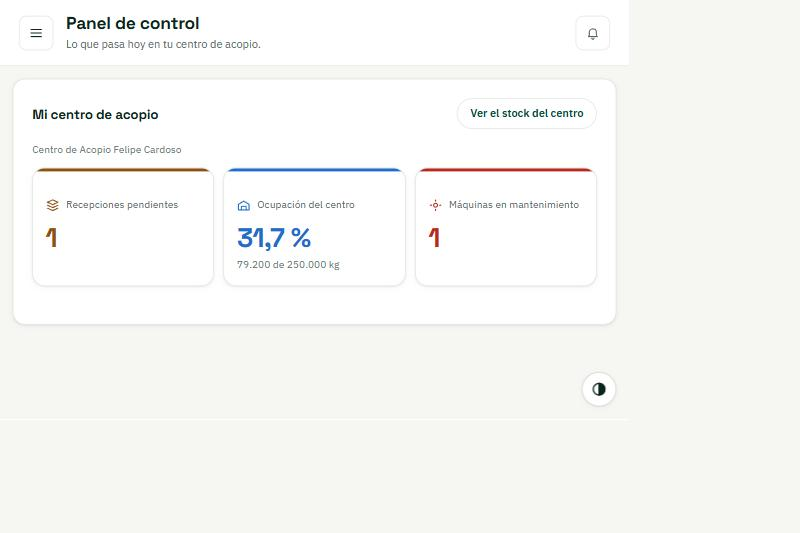

# Manual del Operario de centro de acopio

**Para qué sirve.** El operario trabaja en **un** centro de acopio: recibe lo que traen los camiones, lleva el stock por tipo de residuo,
registra lo que sale y mantiene al día el estado de la maquinaria. Solo ve su centro. No ve incidencias, usuarios ni recolecciones sueltas.
El **administrador** es quien te asigna el centro (en «Usuarios»); si todavía no te lo asignó, el sistema te lo avisa y no podés operar.

## 1. Entrar

**Ingresar** con tu correo y contraseña. Si no la tenés o la perdiste, la administración te la define (no hay «Olvidé mi contraseña»). Menú: **Inicio**, **Mapa**, **Centros de acopio**, **Recepciones** y **Maquinaria**.

## 2. Inicio

*Inicio del operario: recepciones pendientes, ocupación del centro y máquinas en mantenimiento*

Tres tarjetas de tu centro: **Recepciones pendientes** (te lleva a la lista), **Ocupación del centro** (porcentaje y kg sobre la capacidad) y
**Máquinas en mantenimiento**. Si el centro pasó del 80 % de su capacidad aparece un aviso: conviene planificar un retiro.

## 3. Recibir una recolección

1. **Recepciones** lista las recolecciones que van a tu centro y todavía no se recibieron (también las que están en camino). El filtro
   «Mostrar» cambia a las ya recibidas o a todas.
2. Tocá **Recibir** (o el número REC-). Ves los datos de la recolección y **lo que declararon los vaciados**, por tipo de residuo.
3. Pesá lo que descargó el camión y anotá los **kg recibidos de cada tipo**. Ya vienen cargados con lo declarado: corregilos si el pesaje da
   distinto, y agregá un tipo si llegó algo que no estaba declarado. Podés dejar una **Observación**.
4. **Confirmar la recepción** y confirmar en el cuadro. El stock del centro sube en el acto. Una recolección se recibe **una sola vez**.

## 4. Stock del centro

**Centros de acopio** muestra tu centro con su ocupación; tocá el nombre para abrir su ficha:

- **Ocupación** y **stock por tipo de residuo** (cuántos kg de cada uno hay).
- **Registrar un retiro:** elegí el tipo, los kg y el motivo (venta, traslado o disposición final) y una observación si querés. No se puede
  sacar más de lo que hay.
- **Movimientos:** todo lo que entró y salió, con fecha, quién lo registró y de qué recolección vino. **No se borra ni se edita nada:** si
  te equivocás, tocá **Corregir** en esa fila, contá el motivo y el sistema agrega un movimiento inverso. Cada movimiento se corrige una sola
  vez, y una corrección no se corrige. No se puede corregir una entrada si ya salió parte de ese stock.
- **Capacidad:** desde el lápiz de la lista podés actualizar la capacidad (kg) de tu centro. Crear o dar de baja centros, y cambiar su estado, es de la administración.

## 5. Maquinaria

**Maquinaria** muestra el equipamiento de tu centro. En cada fila:

- **Estado:** pasá la máquina a operativa, en mantenimiento o fuera de servicio y escribí una **nota** (qué se hizo o por qué cambia): es obligatoria.
- **Historial:** todos los cambios de estado de esa máquina, con fecha, quién lo hizo y la nota.

Dar de alta, editar los datos o dar de baja una máquina lo hace la administración.

## 6. Mapa

**Mapa** muestra los centros de acopio y los contenedores de la ciudad. Tocá un punto para ver su nombre y dirección.

## Avisos (la campanita)

La **campanita** de arriba a la derecha te avisa cuando **tu centro pasa del 80 % de su capacidad**. Tocá el aviso para abrir la ficha del centro y planificar un retiro;
**Marcar todos como leídos** limpia el contador.

## 7. Preguntas frecuentes

- **Dice que no tengo un centro asignado:** pedile a la administración que te lo asigne en «Usuarios».
- **No veo una recolección que viene hacia mi centro:** solo aparecen las que ya salieron (en curso o finalizadas) y van a tu centro.
- **Cargué mal una recepción o un retiro:** usá **Corregir** en el movimiento (sección 4).
- **No puedo retirar tanto:** el sistema no deja sacar más de lo que hay de ese tipo.
- **Mi sesión se cerró:** pasa tras 2 horas sin usar el sistema; volvé a ingresar.
