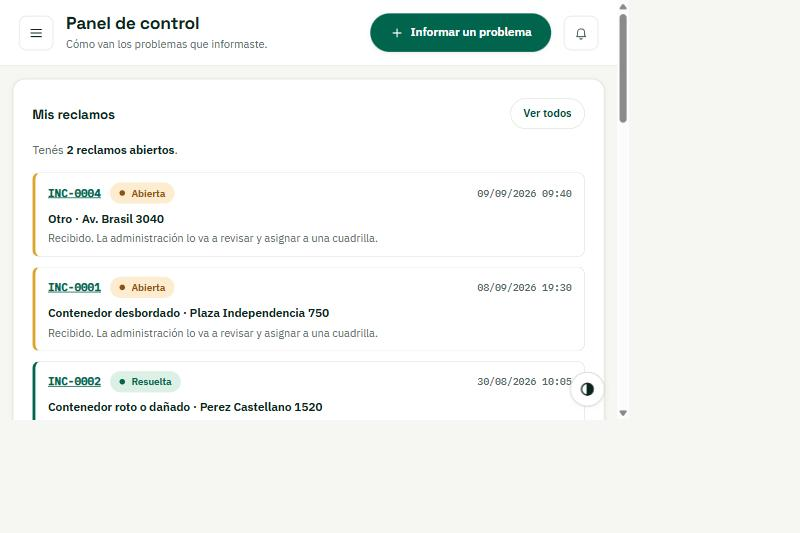

# Manual del Vecino

**Para qué sirve.** SiGeRU le permite a cualquier vecino avisar de un contenedor desbordado, roto o mal ubicado, y seguir el
reclamo hasta que se resuelve. Se usa desde un navegador, en la computadora o en el celular.

## 1. Crear tu cuenta

1. Entrá a la página de SiGeRU y tocá **Crear cuenta de vecino** (o **Quiero registrarme**).
2. Completá **Nombre**, **Apellido**, **Correo electrónico**, **Contraseña** (de 8 caracteres o más) y **Repetir contraseña**.
3. Tocá **Crear mi cuenta**. No hace falta que nadie la apruebe: ya podés **Ir a iniciar sesión**.

Si ya tenés cuenta, tocá **Ingresar** o **Iniciar sesión**, escribí tu correo y tu contraseña y tocá **Ingresar**.
Después de **5 intentos fallidos en 15 minutos** el sistema bloquea ese correo un rato; esperá y probá de nuevo.

## 2. Si perdiste la contraseña

No hay «Olvidé mi contraseña» ni correo de recuperación. Pedile a la administración que te defina una contraseña nueva; te la entrega en mano o por el medio que acuerden.

## 3. Qué ves al entrar

*Inicio del vecino, captura del 19/10/2026 con datos de demostración.*

El menú de la izquierda (en el celular, el botón de las tres rayas) tiene: **Inicio**, **Mapa**, **Informar un problema** y **Mis reclamos**.
Abajo, tu nombre y **Cerrar sesión**. Si pasan **2 horas sin usar** el sistema, la sesión se cierra sola.

## 4. Ver los contenedores en el mapa

**Mapa** muestra los contenedores de la ciudad (verde: disponible, rojo: lleno, naranja: en mantenimiento) y los centros de acopio.
Tocá un punto para ver su código, dirección y estado, y **Informar un problema acá** para empezar un reporte de ese contenedor.
Debajo del mapa hay una tabla con los mismos contenedores y filtros por estado, tipo de residuo y zona.

## 5. Informar un problema

1. Tocá **Informar un problema**.
2. **Contenedor \*:** escribí el código (está pegado en el contenedor, por ejemplo `CNT-004`), elegilo de la lista de sugerencias o buscalo en el mapa.
3. **Tipo de problema \*:** desbordado, roto o dañado, residuo no permitido, ausente o mal ubicado, u otro.
4. **Descripción \*:** contá qué se ve (de 5 a 500 caracteres).
5. **Prioridad que le darías:** alta, media o baja. La administración puede cambiarla.
6. Tocá **Enviar el reporte**. En esta versión no se pueden adjuntar fotos.

Aparece una confirmación con tu **número de reclamo** (por ejemplo `INC-0012`). Guardalo para poder seguirlo.

**Si ya hay un reclamo igual:** si vos o alguien más ya informó ese mismo problema en ese contenedor y sigue abierto, el sistema te lo dice
y no hace falta repetirlo.

## 6. Seguir tus reclamos

**Mis reclamos** lista lo que informaste, con su estado:

| Estado | Qué significa |
|---|---|
| **Abierta** | Recibida; todavía no la tomó ninguna cuadrilla |
| **En curso** | La administración la asignó a una cuadrilla y está en trabajo |
| **Resuelta** | Se solucionó |
| **Descartada** | Se cerró sin intervención (por ejemplo, reporte duplicado), con el motivo |

Tocá el número para ver el detalle: los datos y el **historial** de cada paso. El personal aparece por su función
(Administrador, Cuadrilla), no por su nombre. **El sistema no manda correo cuando cambia el estado:** te avisa en la campanita (ver más abajo) o entrás a mirarlo.

## ¿Cuándo pasa el camión por mi zona?

Esa consulta se retiró de la versión actual el 30/10/2026. El panel ya no aparece en **Inicio**. Si necesitás saber el horario de recolección, consultalo por los canales habituales de la Intendencia.

## Avisos (la campanita)

En la esquina de arriba a la derecha hay una **campanita** con un número: son los avisos que todavía no leíste. Te avisamos cuando tu reclamo **pasa a
«en curso»**, cuando se **resuelve** y cuando se **descarta**. Tocá la campanita para ver los avisos; tocá uno para ir a tu reclamo (queda como leído), o usá
**Marcar como leído** / **Marcar todos como leídos**. Se actualiza sola cada minuto.

Los avisos solo hablan de tus reclamos: nunca traen datos de otras personas.

## 7. Preguntas frecuentes

- **No me deja informar:** solo pueden hacerlo los vecinos con cuenta. Los demás roles (administración, cuadrilla, operario) no reportan.
- **Informé el contenedor equivocado:** avisá a la administración por el medio habitual; el reclamo no se puede editar.
- **¿Quién ve mi nombre?** Solo la administración. La cuadrilla ve el reclamo, no a quién lo informó.
- **El mapa no muestra calles:** necesita internet para el fondo; los puntos se ven igual.
- **No me acuerdo de mi contraseña:** pedile a la administración que te la restablezca (ver «Si perdiste la contraseña»).
